<h1 align="center">One Roof</h1>

<h3 align="center">1× is you.<br>10× is your agent.<br>100× is all of them at once.</h3>

<p align="center">AI already took most engineers from 1× to 10×. The next 10× won't come from a smarter model, or from agents left on autopilot. It comes from running many agents at once with you still steering, deciding and checking. One Roof is the app built for that: every Claude Code, Codex, Kimi, Gemini and Antigravity session in one place, each saying in plain words what it's doing and what it needs from you.</p>

<p align="center">
  <a href="https://github.com/gaurav8936/oneroof/releases/latest"><b>⬇ Download for Mac (.zip)</b></a> ·
  <a href="https://gabblegrid.ai/blog/one-workspace"><b>Read the blog</b></a> (the inspiration behind it) ·
  <a href="https://gaurav8936.github.io/oneroof/">Website</a> ·
  <a href="docs/help/00_getting-started.md">Getting started</a> ·
  <a href="CONTRIBUTING.md">Contribute</a>
</p>

<p align="center">
  <a href="https://github.com/gaurav8936/oneroof/releases/latest"></a>
  <a href="https://github.com/gaurav8936/oneroof/actions/workflows/test.yml"></a>
  
  
  <a href="LICENSE"></a>
</p>

<p align="center"><sub>Open source · MIT · native macOS app · macOS 14 or later · one download, plus your agents</sub></p>

<p align="center">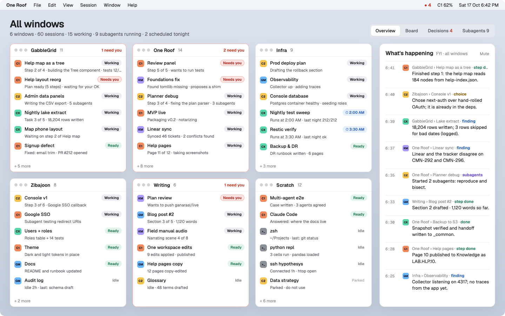</p>

<p align="center"><b>The players:</b> Claude Code · Codex · Kimi · Gemini · Antigravity<br>
<sub>Up to two Claude accounts and one of each other agent, found automatically. Claude and Codex show live usage,
and new work goes to the seat with room.</sub></p>

## Each jump changes what your job is.

Every 10× moved the bottleneck. At 100× it lands on the one thing that doesn't scale: your attention, and the judgment you spend it on.

| | |
|---|---|
| **1×** · You write the code | One editor, one terminal, one task. The bottleneck is how fast you type and think. |
| **10×** · Your agent writes it | You describe, it builds, you review. One session in one terminal still fits in your head. This is where most engineers are today. |
| **100×** · All of them, with you steering | Twenty sessions across agents, subscriptions and repos. The agents do the typing. You decide which task, which agent, whether it's right and whether it's done. This is what One Roof is for. |

**Getting from 10 to 100 isn't about any single agent. It's about how cheaply you can move between all of them, and how well you can judge what they did.**

## A hundred agents on autopilot is a story. Judgment is the job.

There's a popular idea that the next step is hands-free: start a hundred agents, walk away, come back to finished work. For a few tasks, maybe. For most real work, it won't happen.

Even when an agent can finish a task on its own, someone still has to decide it was the right task, notice when it took a wrong turn and judge whether the result is any good. That judgment is what experienced engineers bring, and it doesn't scale by adding agents.

It scales by making it cheap to apply. The terminal was made for one person and one session. Run twenty and every tab looks the same. Which one needs you? Which one finished? Which subscription is about to run out? Did that agent even read your rules?

**Context switching is the job now. One Roof makes it cheap: glance, decide, move on.**

## Six things that cost you judgment time, and what One Roof does about each.

Each one is fine at three sessions. Each one is what caps you at twenty.

| What breaks | What One Roof does |
|---|---|
| **You can't tell sessions apart.** Every tab has the same grey icon, so you type WIP: or NEXT: in front of the name. | Every session labelled with its state, agent, account and a live one-line status. |
| **Nobody reads the wall of text.** At 100×, reading every stream is the whole day. | A summary of what you asked, what it's doing now and how far along it is. |
| **Approvals block everything.** Questions pile up in tabs you aren't looking at, and come with no reason. | One queue for every decision, with the reason, the risk and what happens if you say no. |
| **Subscriptions run out mid-task.** More agents means more limits, and you find out when one stops. | Remaining usage on each seat steers new work; a step hands off before a limit hits. |
| **Agents drift apart.** More sessions, more ways to start one in the wrong folder with the wrong memory. | One launch folder, one memory and one rulebook, checked every time the app starts. |
| **Work lives in three places.** The tracker, Linear and your tabs never agree. | Board, Work and tickets inside the app. Every session knows its ticket. |

## You already use more than one model. Your coding agents are next.

In chat, few people are loyal to one model any more: one for writing, another for reasoning, a third because it's quick or cheap. Coding agents are still treated as monolithic. You pick Claude Code, or Codex, and you stay.

That won't last. Agents differ in what they're good at, which model family they bring and how much room is left on each subscription. The next step is using the right one for each task: plan, build, review, research, chores, and the loops that run every night.

Each vendor's own app is built to keep you inside that vendor's agent. One Roof isn't any vendor's. Claude Code, Codex, Kimi, Gemini and Antigravity run side by side, and your rules decide who takes what.

**A neutral home for agentic engineering: agentic code today, agentic everything next.**

## What running fifty agents taught us, built into the app.

We ran five subscriptions across 27 repos for weeks and wrote down everything that broke. One Roof doesn't just document those lessons. The kit puts them in place, and the app checks them every time it starts and shows you anything that's missing. The full story is in the blog post that started it: **[One workspace: five coding agents, one set of rules](https://gabblegrid.ai/blog/one-workspace)**.

| Lesson from the field notes | How One Roof enforces it |
|---|---|
| **The start folder is load-bearing.** It decides which rules an agent loads and where it writes its notes. 32 of 168 sessions started in the wrong one, and nothing errored. | Sessions launch in your workspace, and the launch-folder guard is checked every time the app starts. |
| **Block, don't warn.** A "deprecated" marker file is advice, and agents don't read advice in files they never open. | Five layers that refuse rather than remind: shell default, agent wrappers, PATH stand-ins, a Claude hook, locked home notes. |
| **A door at every level.** Every agent reads its rules under a different name from a different folder. Kimi found no rules at all in 21 of 27 repos. | CLAUDE.md, AGENTS.md and GEMINI.md doors all lead to one READ-FIRST, and one skills library is linked into every agent. |
| **"Memory" is four things.** Context, transcripts, private notes and the shared record. Only the record in git is seen by every agent. A split notes folder hid 26 notes. | One pinned Claude memory, checked at startup, with a warning when its index grows too long to load. |
| **Handoffs belong in git.** The next session may be a different agent, a different subscription or tomorrow morning. | last-call, next-session-handoff and where-are-we ship in the kit, writing handoffs any agent can pick up cold. |
| **Bound the fan-out.** An unbounded swarm can take down the laptop it runs on. The machine is the limit, not the token budget. | A worktree per worker, one owner per shared file, and a runner with a ceiling, timeouts and capped retries. |

## The tour

### Read the summary, not the stream.
What you asked, what it's doing right now, and steps 3 of 4. Finished steps fold into one-line chapters; the live
step stays a real terminal. Subagents sit beside it with their own captions.

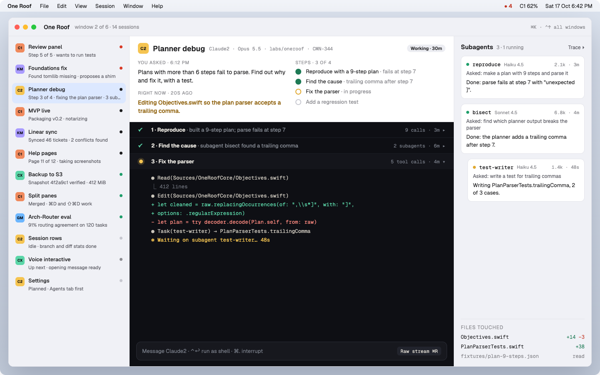

### The calls that need you, with the reason in front of you. <sub>Decisions · ⌘I</sub>
Every agent waiting on you, oldest first: why it wants to do it, what it touches, the risk, what happens if you say
no. Allow once, always allow, deny, or reply with instructions. Nothing is approved for you.

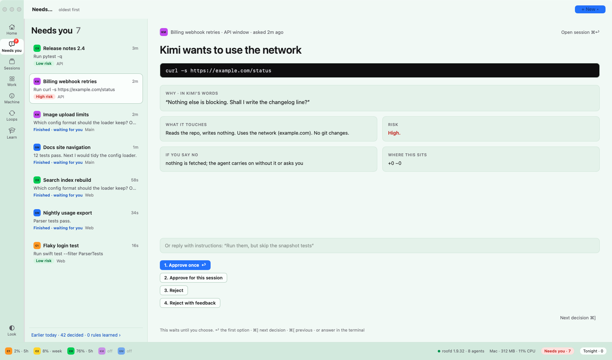

### Plan your day by dragging cards. <sub>Board · ⌘B</sub>
Planned, Next, Working, Needs you, Ready, Tonight: every session across every window on one board. Drag a card to
Next, or drop it on Tonight to run at 2 AM, nightly or on demand.

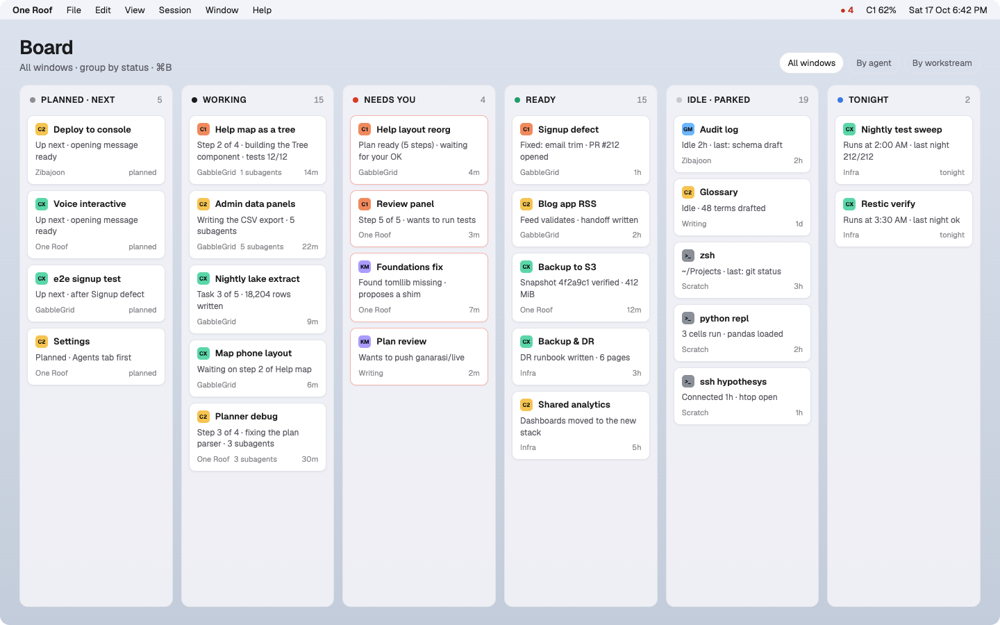

### See the agents your agents start. <sub>Subagents · ⇧⌘A</sub>
A timeline of every subagent: who asked it what, the model, tokens, how long it took and what it's doing now.

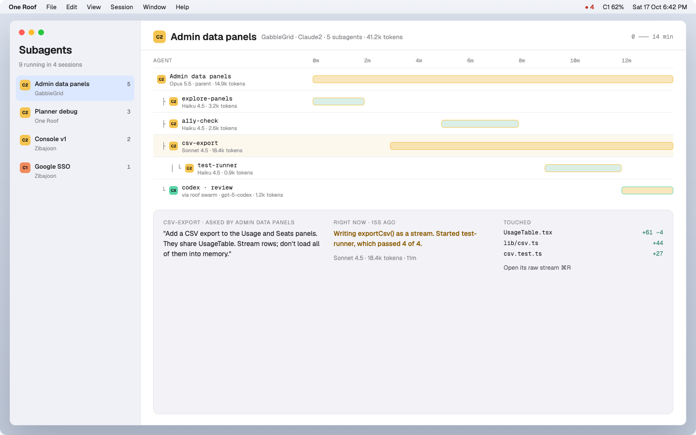

### Say what should happen. It works out who does it. <sub>New session · ⌘N</sub>
One Roof works out whether this is a session, a ticket, a defect or a project, finds similar tickets, and puts the
router's suggestion on top with its reason. Launch now, queue it next, or schedule it for tonight. The routing is your
rules plus each seat's remaining usage; an optional on-device model (Qwen3 1.7B, Apache-2.0) sorts the task into a kind in about 0.15 s.

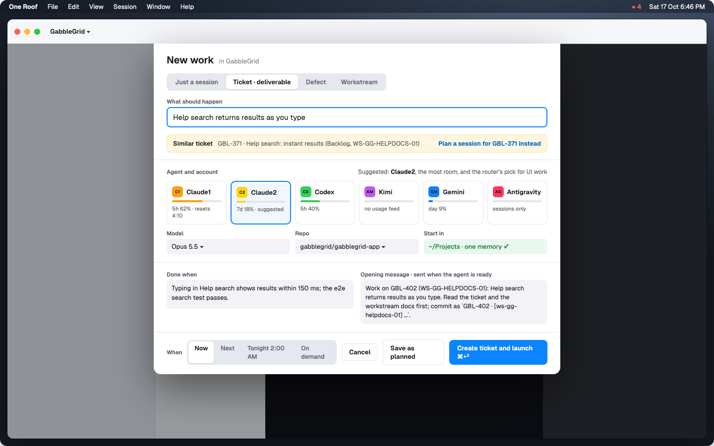

### Still a real terminal, with each panel in its own theme. <sub>Workspace</sub>
Sessions, files, terminal and plan side by side, built on Ghostty's renderer, with ⌘D and ⇧⌘D to split panes.
Agents keep running when you quit the app. Each panel can be light, mid-grey or dark on its own.

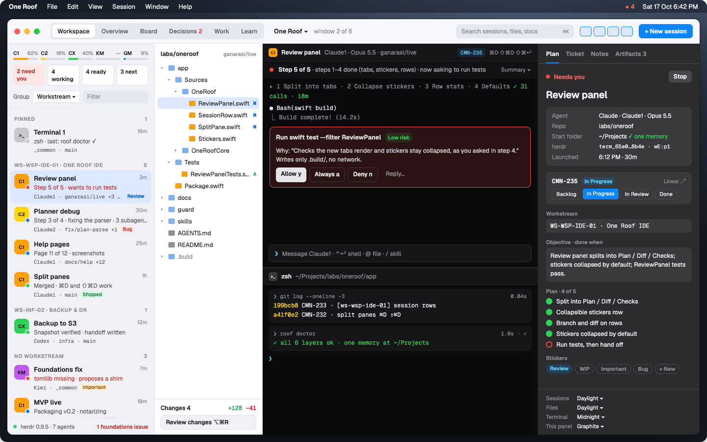

### Edit, run and review without leaving. <sub>Editor · Review changes</sub>
Edit and run, with problems listed beside the code. Lines an agent changed carry its colour. Review the diff, comment
on a line to send it back to the agent, then commit.

| | |
|---|---|
| 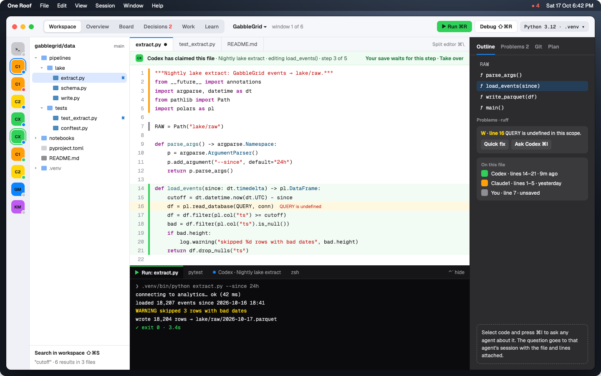 | 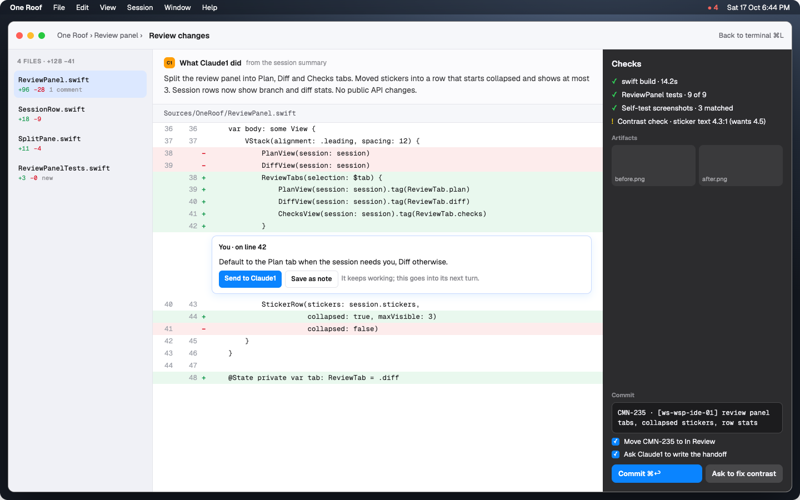 |

### Your roadmap and a coach, built in. <sub>Work · Learn</sub>
Work shows your projects and tickets by phase, with the session working on each one. Learn is an
agentic-engineering coach: a 12-lesson narrated course and 17 starter skills ([`agentic_engineering/`](agentic_engineering/)).
Listen in the app, or send a skill straight to a session.

| | |
|---|---|
| 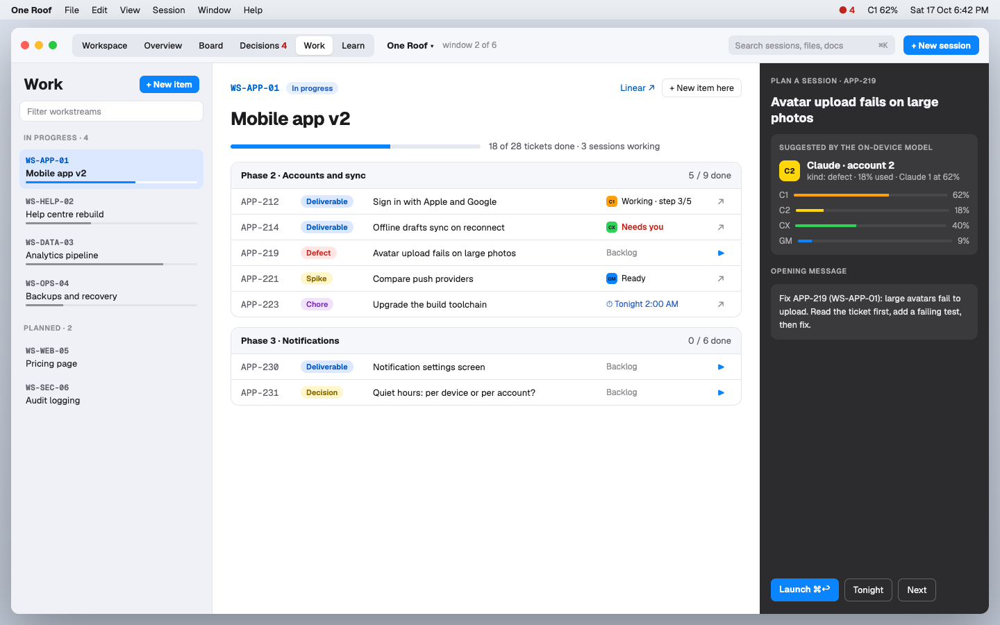 | 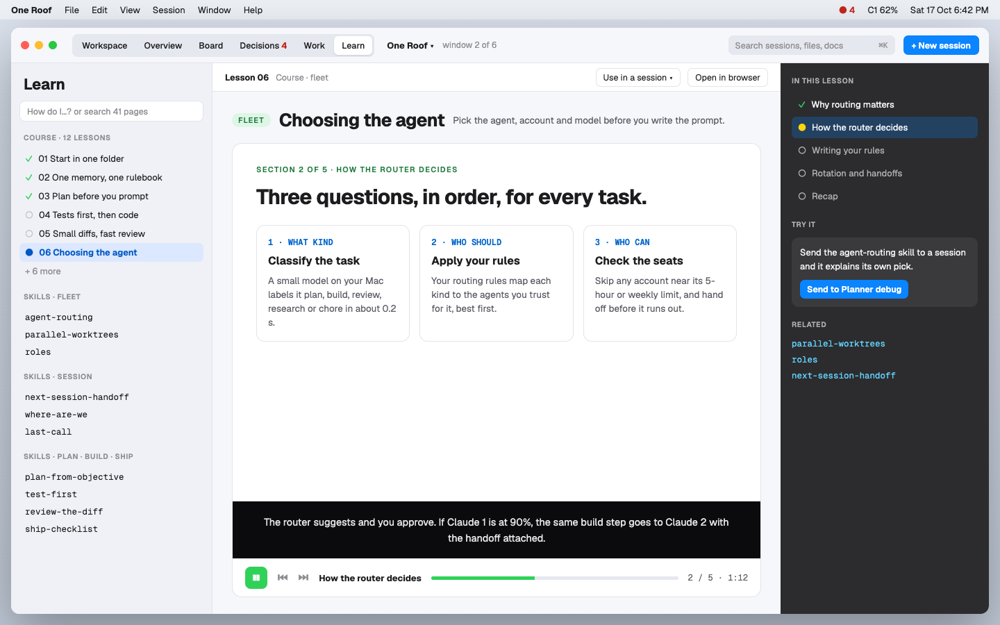 |

<sub>Screens show a busy, real-world workspace. Your own sessions, repos and tickets appear in their place.</sub>

## What's in this repo

| Part | Folder | What it is |
|---|---|---|
| **One Roof app** | [`app/`](app/) | The macOS app (Swift, libghostty terminals, roofd sessions) |
| **Agentic engineering starter set** | [`agentic_engineering/`](agentic_engineering/) | 17 short skills and a 12-lesson narrated course, bundled with the app |
| **The kit (`roof`)** | `bin/ guard/ shell/ lib/ templates/ tools/` | One launch folder, one memory, one rulebook for every agent, plus `roof swarm` for parallel agents in git worktrees. Works with or without the app |
| **Website** | [`site/`](site/) | The launch page, published at [gaurav8936.github.io/oneroof](https://gaurav8936.github.io/oneroof/) |

> **Early release (0.5.2.2).** Used daily on one Mac and tested on Apple-silicon Macs only. Expect rough edges,
> especially in first-run setup and agent detection on machines unlike ours. Please
> [open an issue](https://github.com/gaurav8936/oneroof/issues) with what you find; see [CONTRIBUTING.md](CONTRIBUTING.md).
> Known limits: Apple silicon only; the optional on-device model needs `brew install llama.cpp` (the model itself is one click: **Get the model**).

## Install the app

**What you need**

| | What | How |
|---|---|---|
| Required | A Mac with Apple silicon, macOS 14 or later | |
| Required | git | `xcode-select --install` (Xcode Command Line Tools) |
| Required | At least one agent CLI, installed and signed in: `claude`, `codex`, `kimi`, `gemini` or `agy` | each agent's own installer |
| Optional | On-device task classifier and captions | `brew install llama.cpp`, then **Get the model** in Settings › Foundations (Qwen3 1.7B, Apache-2.0, 1.1 GB) |
| Optional | Work view (projects and tickets) | a Linear API key, entered at setup or in Settings |
| Optional | Seat gauges for Claude | a Claude Code status line that writes usage files (see the help page on seats) |

Xcode, zig and the libghostty build are only needed to build from source.

1. Download `One-Roof-<version>.zip` from [Releases](https://github.com/gaurav8936/oneroof/releases), unzip it, and move
   **One Roof.app** to Applications.
2. **Open it.** The app is signed with an Apple Developer ID and notarized by Apple, so it opens like any other app
   (macOS asks once to confirm it came from the internet).
3. **First-run setup** asks for your projects folder, an optional shared folder for rules and handoffs (it can create
   one), and which agentic-engineering folder to use (the bundled one, or your own skills repo). It shows which agents
   it found and whether each is signed in. Everything can be changed later in Settings (⌘,).
4. Optional: a Linear API key (Work view), and the on-device routing model (see [app/README.md](app/README.md)).

**Build from source** instead: see [app/README.md](app/README.md) (Xcode 26, zig 0.15, a one-time libghostty build).

The rest of this page is about **the kit**.

## The kit

If you use Claude Code, Codex, Kimi, Hermes or Gemini on the same projects, and especially if you run several sessions
at once, they only stay consistent if they read the same rules and the same notes. They usually don't:

- **Claude Code keys its memory on the launch folder.** Start a session in `~` instead of `~/Projects` and it reads
  and writes a *different* memory. Nothing warns you. We lost 26 notes to a hidden second memory over five weeks.
- **Every agent finds its instructions from the launch folder** (`CLAUDE.md`, `AGENTS.md`). Start in the wrong place
  and an agent works without your rules.
- **Codex and Kimi have no hooks**, so the usual "block it in a hook" fix doesn't reach them.

oneroof fixes this with the simplest controls that work, layered so a mistake has to get past all of them:

| # | Layer | What it does |
|---|---|---|
| 1 | Shell default | a new terminal that opens in `~` moves to your workspace |
| 2 | Agent wrappers | typing `claude` / `codex` / `kimi` elsewhere moves you first |
| 2b | PATH stand-ins | agents without hooks **refuse to start** outside the workspace (exit 64), even via `command codex` |
| 3 | Claude hook | **blocks every prompt** while a Claude session is outside the workspace |
| 4 | Home notes | `~/CLAUDE.md` + `~/AGENTS.md`: "wrong folder, stop" (conditional, optionally made immutable) |
| 5 | Memory pin | `autoMemoryDirectory`: one Claude memory, whatever the launch folder |

…plus the parts that keep agents consistent once they start in the right place:

- **A shared rulebook** (`_common/AGENTS.md`, with `CLAUDE.md` linked to it) that every agent's entry file points at,
  and a short `READ-FIRST.md` must-read list.
- **Handoffs in git**: the `next-session-handoff`, `last-call` and `where-are-we` skills write and read session
  bridges that any agent can resume from.
- **A starter set of agentic-engineering skills and a narrated course** in [`agentic_engineering/`](agentic_engineering/):
  17 short skills (plan, test-first, review, routing, parallel worktrees, shipping, gotchas) and 12 lessons. One Roof
  bundles it and uses it unless you point Settings at your own skills folder.
- **One skills folder for every agent**: `roof sync-skills` links each skill into Claude's, Codex's, Hermes's and
  Gemini's skills homes.
- **Bounded parallel agents**: `roof swarm run spec.json` runs tasks in separate git worktrees with non-overlapping file
  claims, a parallel ceiling, timeouts, capped retries and a disk check; `merge` and `clean` land and tidy the run.

The story behind it: *One workspace: the boring rules that made our agents agree* (gabblegrid.ai/blog).

### Install the kit

```bash
git clone https://github.com/gaurav8936/oneroof ~/oneroof
~/oneroof/bin/roof install                      # workspace ~/Projects, shared folder ~/Projects/_common
# or: roof install --workspace ~/code --agents "claude codex kimi hermes"
# open a new terminal, then:
roof doctor                                           # checks every layer, live
```

Add `~/oneroof/bin` to your `PATH` to type `roof`. `roof install --dry-run` shows what it would do. Install is
idempotent and **never overwrites** an existing file: your `~/CLAUDE.md`, your rulebook and your settings keys are
left alone (Claude's settings are merged, with a timestamped backup).

On macOS, `roof lock` prints the `sudo chflags` commands that make the home notes immutable. oneroof never runs
`sudo` itself.

### Commands

| Command | Does |
|---|---|
| `roof install [--workspace DIR] [--shared DIR] [--agents "…"] [--no-shell] [--no-home-notes] [--dry-run]` | set up every layer |
| `roof doctor` | check every layer live (blocks a fake session in `~`, starts a stand-in in `~`); exit 1 on any problem |
| `roof status` | show workspace, shared folder, agents, memory folder |
| `roof sync-skills <dir>` | link one skills folder into every agent's skills home (e.g. `agentic_engineering/skills`) |
| `roof swarm run spec.json [--dry-run]` | run tasks in parallel, one git worktree + branch each, non-overlapping file claims, timeouts, capped retries, disk check (`roof swarm --help`) |
| `roof swarm merge <run-dir>` | merge each green task branch into the current branch (`--no-ff`), stopping at the first conflict |
| `roof swarm clean <run-dir> [--force]` | remove the run's worktrees and its merged branches (`--force`: all its branches) |
| `roof lock` | print the commands that lock the home notes (macOS) |
| `roof uninstall` | remove what install added; your docs and memory stay |

One-off exception (owner only): `ROOF_ALLOW_OUTSIDE=1 claude`.

### What gets created

```
~/Projects/                     your workspace (any path)
  CLAUDE.md                     imports _common/AGENTS.md
  AGENTS.md                     points Codex/Kimi/Hermes at _common/AGENTS.md
  _common/                      the shared layer (the underscore sorts it first everywhere)
    AGENTS.md  CLAUDE.md → AGENTS.md
    docs/READ-FIRST.md  docs/standards/  decisions/  architecture/  runbooks/  references/  gotchas/  next-session-handoff/
~/CLAUDE.md  ~/AGENTS.md        conditional "wrong folder" notes
~/READ-FIRST.md                 link to the shared READ-FIRST
~/.claude/settings.json         + autoMemoryDirectory + two hooks (merged)
~/.config/oneroof/        config + bin/ stand-ins for codex, kimi, …
~/.zshrc / ~/.bashrc            + one line sourcing shell/oneroof.sh
```

## How it fits together

[docs/architecture/oneroof-kit.md](docs/architecture/oneroof-kit.md) explains the guarantees, the four context layers (shared truth → entry
files → private memory → session bridge) and why each layer exists. [docs/runbooks/adding-an-agent.md](docs/runbooks/adding-an-agent.md)
covers adding another agent, including Hermes, which keeps its own memory.

## Tests

```bash
bash tests/run.sh      # 59 checks in a throwaway HOME with fake agents: no real settings, shells or tokens touched
```

CI runs them on Ubuntu and macOS.

## Licence

MIT
