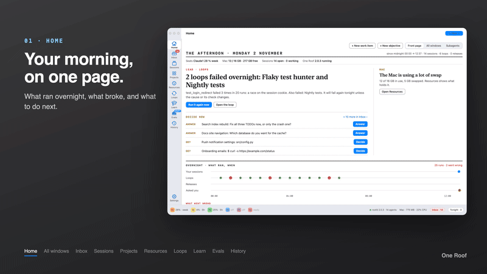
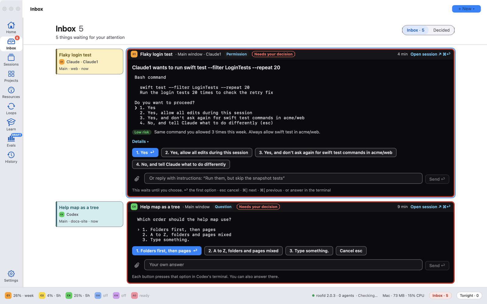
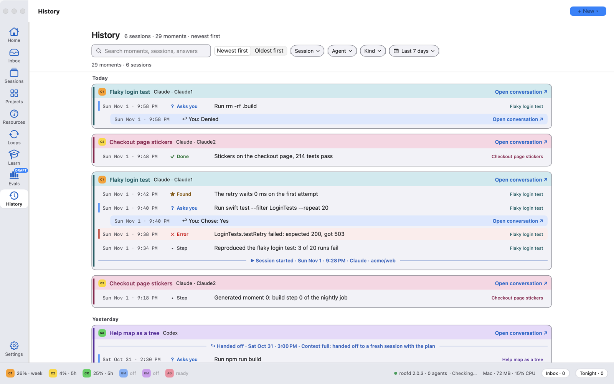
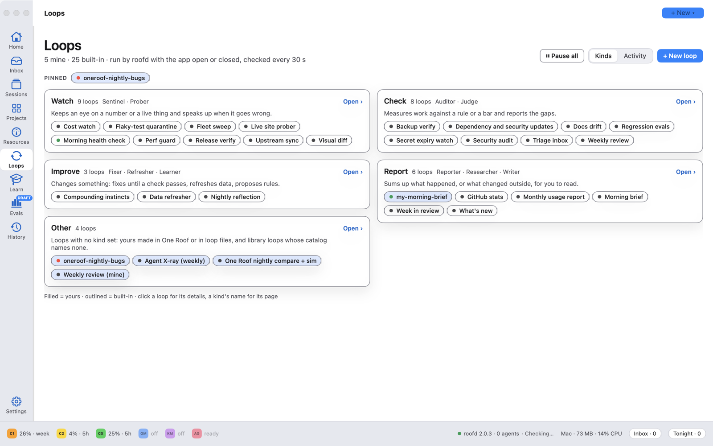
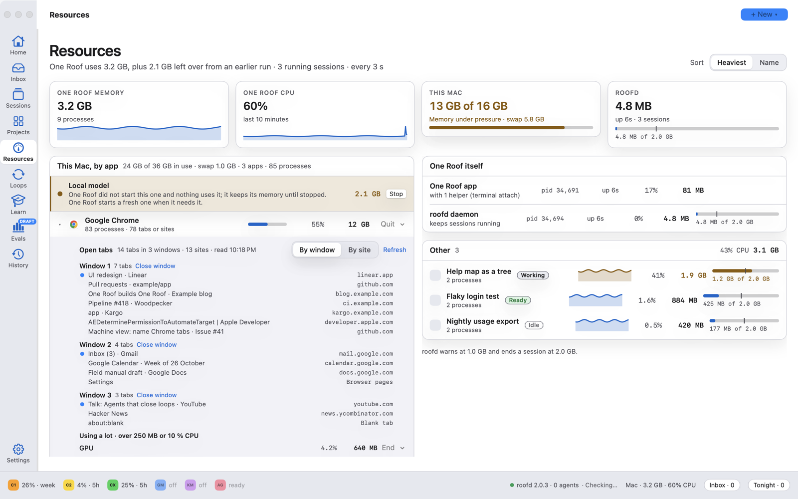
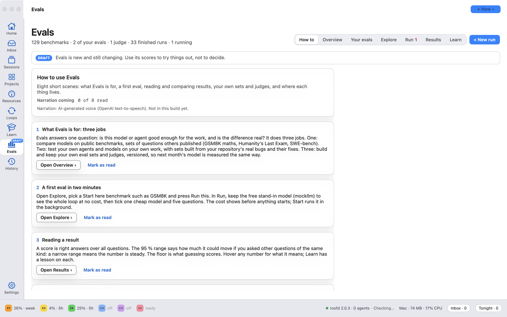

<h1 align="center">One Roof</h1>

<h3 align="center">The agents aren't the bottleneck anymore. You are.</h3>

<p align="center">One Roof is a new kind of place to build with agents. One place to keep up. You stay in charge. Not an IDE, not a terminal. Run Claude Code, Codex, Gemini CLI, Kimi and Antigravity side by side, each one the real tool. Your sessions keep running when you close the window, update the app, or even if the background service crashes, so no agent loses its work. Everything they ask lands in one Inbox, answered with a click. Each morning, Home shows what ran overnight, what broke and what to do next. Learn and Resources are built in. Free and open source.</p>

<p align="center">
  <a href="https://github.com/gaurav8936/oneroof/releases/latest"><b>⬇ Download for Mac (.zip)</b></a> ·
  <a href="https://gaurav8936.github.io/oneroof/">Website</a> ·
  <a href="https://console.zibajoon.com/blog/chorus-coding">Chorus coding</a> (the idea behind it) ·
  <a href="docs/help/00_getting-started.md">Getting started</a> ·
  <a href="docs/help/00_setup-guide.md">Setup guide</a> ·
  <a href="CONTRIBUTING.md">Contribute</a>
</p>

<p align="center">
  <a href="https://github.com/gaurav8936/oneroof/releases/latest"></a>
  
  
  <a href="LICENSE"></a>
</p>

<p align="center"><sub>Free · open source · MIT · signed and notarized · needs macOS 14 or later on Apple silicon</sub></p>

> **Status: version 2.0.3.** Free and open source under the MIT licence. Tested on Apple-silicon Macs only.
> Evals is still a draft, and is marked as one in the app. Please
> [open an issue](https://github.com/gaurav8936/oneroof/issues) with anything that breaks or reads badly; see
> [CONTRIBUTING.md](CONTRIBUTING.md).

<p align="center"><a href="https://youtu.be/POorMcHkzHE"></a></p>

<p align="center"><a href="https://youtu.be/POorMcHkzHE"><b>▶ Watch the full 2:46 demo on YouTube</b></a></p>

**Works with:** Claude Code · Codex · Gemini CLI · Kimi · Antigravity · plain shells

One Roof finds the agent command-line tools on your Mac and the accounts you are signed in to. It does not replace
them: each session runs the real tool, and you can always type straight into it. Optional:
OpenCode and Goose on a hosted model with your own API key and a spending cap.

## The idea: chorus coding

I call it chorus coding: several coding agents on the same piece of work, each doing the part it does best, one
checking another. One plans, one builds, one reviews. A loop re-runs the tests every night.

The agents are not the bottleneck any more. You are. Five terminals look the same. A question waits in a tab you are
not looking at. Something failed at 3 AM and nobody told you. The Mac slows down and you do not know which session is
to blame.

One Roof is the app I built to keep up with that, and to stay the one who decides.
More in the post: [Chorus coding](https://console.zibajoon.com/blog/chorus-coding).

## Six things that go wrong with many agents

Each one is easy with one session. Each one adds up with five.

| What goes wrong | What One Roof does |
|---|---|
| **Questions get lost.** An agent stops to ask something in a tab you are not watching, and waits for an hour. | **Inbox:** every ask from every session in one place, the urgent ones first, answered in place. |
| **You miss what happened overnight.** Loops and long sessions ran while you slept. Which ones failed, and what now? | **Home:** a morning front page with what went wrong, what to do next and what ran fine. |
| **Nobody reads the whole stream.** Reading every agent's output is a full-time job. | **History:** the important moments of each session, as short cards, with what you answered. |
| **Every terminal looks the same.** You end up typing WIP: in front of tab names to tell them apart. | **Sessions:** each one labelled with its state, agent, account and folder, and its own colour. |
| **The Mac slows down.** One session's processes quietly grow to several gigabytes. | **Resources:** memory and CPU per session and per app, with a guard that stops a runaway session. |
| **Agents act before you look.** An agent edits files or runs commands you did not expect. | **Permissions per agent.** On a new Mac every agent starts in Manual and asks first. |

## The tour

The window has a rail of places, each with one job.

### Home: a front page for the morning
Built from your own sessions and loops. The lead story is the thing that matters most. **Decide now** lists what
waits on you, one button each. The overnight timeline shows every run since midnight as a dot, and under it:
**What went wrong** (each failure once), **What to do next** (up to three steps) and **Ran fine** (repeats folded,
such as "Cost watch ×12").

### Inbox · ⌘I: everything the agents ask you, in one column
One block per session that needs you, with the prompt's own options as buttons (or press 1–9). When an agent is
blocked until you act, its block gets a red border and goes to the top. A finished turn waits here too, with a reply
box; paste a screenshot and the agent reads it. Nothing is approved for you, and you can always answer in the
terminal instead. **Decided** keeps what you answered, newest first.



### Sessions: real terminals that keep running
Every agent session and plain shell, grouped by state: Needs you, Active, Next, Planned, Exited. Each row shows the
agent, the account, the folder and a live one-line status. Show one terminal, a grid or a wall. Sessions run inside
**roofd**, a small background service, so they keep going when you close the app, and come back with their screens
when you open it again.

### History: what happened while you were away
A read-only record of each session's important moments: steps, findings, errors, what the agent asked and what you
answered, hand-offs between sessions. Each session's run of moments is one card, in its own colour. Search it, or
filter by session, agent, kind and date. Kept for 30 days.



### Loops: work that repeats until a check passes
A loop gives an agent a goal and a check, such as "until the tests pass" or "every night at 3". One Roof runs the
check, starts another round when it fails, and stops at a limit. The agent works in the loop's own copy of the repo,
never in yours. What a loop produces waits in the Inbox for your approval.

1. **Check first.** If it already passes, no agent is started.
2. **One round.** The agent works on a separate branch.
3. **Check again.** Done, or another round, up to a limit.
4. **You decide.** A loop never pushes, merges or deploys on its own.

The built-in loops are off until you turn one on.



### Resources: see which session is slowing the Mac
Memory and CPU for each session, for One Roof itself and for every app on the Mac, with 10-minute charts. A browser
shows its windows and tabs, and you can close a tab or a window from here. roofd warns when a session grows past 1 GB
and ends it at 2 GB, before it can freeze the Mac.



### Evals (draft): measure agents and models on your own work
Still a draft, and marked as one in the app. Run public benchmarks or build a question set from your own repo's fixed
bugs, then compare agents and models on it. Every score comes with its range and a plain explanation of what it means.
The cost shows before anything starts.



### Also on the rail, both optional
- **Projects:** your Linear teams, projects and tickets, with each project's roadmap. Only if you connect Linear with
  your own API key; without it, Projects shows a single Connect Linear card.
- **Learn:** a course on agentic engineering. The narrated Agentic Engineering deck and a timeline of papers that
  shaped coding agents. The narration is an AI-generated voice, and says so.

## Safe by default

One Roof never decides for you. These are the defaults on a new Mac.

- **Manual first.** Each agent has one permission mode: Manual, Plan, Auto or Full. On a new Mac every agent starts
  in Manual and asks before it edits a file or runs a command. Change it per agent in Settings › Permissions.
- **Nothing is approved for you.** The Inbox shows the agent's own options. You press one, or answer in the terminal.
  Loops stage their results for your approval and never merge on their own.
- **Your folders, not your home folder.** Setup asks for the folder that holds your code, or offers to create
  `~/Projects`. One Roof never scans your home folder, so macOS does not ask about Desktop, Documents or Downloads.
- **Sessions survive the app.** roofd keeps your sessions running when One Roof is closed or updated. A crash in one
  session ends only that session.
- **No keys in the app.** The app ships no keys, no tokens and no datasets. Linear, hosted models and gated
  benchmarks use your own accounts, only if you add them.
- **Signed and open.** Signed with an Apple Developer ID and notarized by Apple. The full source is here, under the
  MIT licence.

## Not tied to one vendor's agent

Agents differ in what they are good at, which model they bring and how much room is left on each subscription. Each
vendor's own app keeps you inside that vendor's agent. One Roof is no vendor's: Claude Code, Codex, Gemini CLI, Kimi
and Antigravity run side by side. The bar at the foot of the window shows how much of each subscription is used, so
you can pick the agent with room left.

## Install the app

**What you need**

| | What | How |
|---|---|---|
| Required | A Mac with Apple silicon, macOS 14 or later | |
| Required | git | `xcode-select --install` (Xcode Command Line Tools) |
| Required | At least one agent CLI, installed and signed in: `claude`, `codex`, `gemini`, `kimi` or `agy` | each agent's own installer (Gemini CLI needs a Gemini API key; Antigravity signs in with a Google account) |
| Optional | OpenCode or Goose on a hosted model | OpenCode 1.19.5 or Goose 1.57.0, Python 3.11+ with PyYAML, and an API key for Together AI, OpenRouter or Fireworks (see [hosted agents](docs/help/hosted-agents.md)) |
| Optional | On-device model for captions and reasons | `brew install llama.cpp`, then **Get the model** in Settings (Qwen3 1.7B, Apache-2.0, 1.1 GB; it runs on your Mac) |
| Optional | Projects (Linear) | your own Linear API key, in Settings › Linear |

1. **Download** `One-Roof-<version>.zip` from [Releases](https://github.com/gaurav8936/oneroof/releases/latest),
   unzip it and drag **One Roof** to Applications. It is signed and notarized by Apple, so it opens like any other app.
2. **Run the setup.** The first launch finds the agents you are signed in to, asks for the folder that holds your
   code, and lets you pick a look. macOS asks once to allow roofd, the background item that keeps sessions running.
   Every answer can be changed later in Settings (⌘,); the [setup guide](docs/help/00_setup-guide.md) explains each one.
3. **Start your first session.** Press ⌘N, say what should happen, pick the agent and the repo, and launch (⌘↩).
   When it asks you something, it shows up in the Inbox.

**Build from source** instead: see [app/README.md](app/README.md) (Swift 6, Xcode 26, zig 0.15 and a one-time
libghostty build).

## What's in this repo

| Part | Folder | What it is |
|---|---|---|
| **One Roof app** | [`app/`](app/) | The app (Swift, libghostty terminals) and roofd, the session service |
| **Agentic engineering linking** | [`agentic_engineering/`](agentic_engineering/) | The script that links the bundled deck's skills into every agent; the deck itself is packaged from its own repository when the app is built |
| **The kit (`roof`)** | `bin/ guard/ shell/ lib/ templates/ tools/` | One launch folder, one memory and one rulebook for every agent. Works with or without the app |
| **Help** | [`docs/help/`](docs/help/) | The help pages the app shows |
| **Website** | [`site/`](site/) | The page at [gaurav8936.github.io/oneroof](https://gaurav8936.github.io/oneroof/) |

## The kit

Agents only stay consistent if they start in the same folder and read the same rules and notes. They usually don't:

- **Claude Code keys its memory on the launch folder.** Start a session in `~` instead of `~/Projects` and it reads
  and writes a *different* memory. Nothing warns you. I lost 26 notes to a hidden second memory over five weeks.
- **Every agent finds its instructions from the launch folder** (`CLAUDE.md`, `AGENTS.md`, `GEMINI.md`). Start in the
  wrong place and an agent works without your rules.
- **Codex and Kimi have no hooks**, so the usual "block it in a hook" fix doesn't reach them.

The kit fixes this with simple controls, layered so a mistake has to get past all of them. `roof install` puts them
in place; `roof doctor` checks every layer.

| # | Layer | What it does |
|---|---|---|
| 1 | Shell default | a new terminal that opens in `~` moves to your workspace |
| 2 | Agent wrappers | typing `claude`, `codex` or `kimi` anywhere else moves you there first |
| 2b | PATH stand-ins | agents without hooks **refuse to start** outside the workspace (exit 64), even via `command codex` |
| 3 | Claude hook | **blocks every prompt** while a Claude session is outside the workspace |
| 4 | Home notes | `~/CLAUDE.md` and `~/AGENTS.md` say "wrong folder, stop" (optionally made immutable) |
| 5 | Memory pin | `autoMemoryDirectory`: one Claude memory, whichever folder you launch from |

It also sets up:

- **A shared rulebook** (`_common/AGENTS.md`, with `CLAUDE.md` linked to it) that every agent's entry file points at,
  and a short `READ-FIRST.md` must-read list. `roof doors` puts a small door file at every project and repo level.
- **One skills folder for every agent**: `roof sync-skills` links each skill into Claude's, Codex's, Gemini's and
  Hermes's skills homes.
- **Bounded parallel agents**: `roof swarm run spec.json` runs tasks in separate git worktrees with non-overlapping
  file claims, a parallel ceiling, timeouts, capped retries and a disk check; `merge` and `clean` land and tidy the run.

The story behind it: [One workspace: five coding agents, one set of rules](https://gabblegrid.ai/blog/one-workspace).

### Install the kit

```bash
git clone https://github.com/gaurav8936/oneroof ~/oneroof
~/oneroof/bin/roof install                      # workspace ~/Projects, shared folder ~/Projects/_common
# or: roof install --workspace ~/code --agents "claude codex kimi gemini agy"
# open a new terminal, then:
roof doctor                                     # checks every layer, live
```

Add `~/oneroof/bin` to your `PATH` to type `roof`. `roof install --dry-run` shows what it would do. Install is
idempotent and **never overwrites** an existing file: your `~/CLAUDE.md`, your rulebook and your settings keys are
left alone (Claude's settings are merged, with a timestamped backup).

On macOS, `roof lock` prints the `sudo chflags` commands that make the home notes immutable. The kit never runs
`sudo` itself.

### Commands

| Command | Does |
|---|---|
| `roof install [--workspace DIR] [--shared DIR] [--agents "…"] [--no-shell] [--no-home-notes] [--dry-run]` | set up every layer |
| `roof doctor` | check every layer live (blocks a fake session in `~`, starts a stand-in in `~`); exit 1 on any problem |
| `roof status` | show workspace, shared folder, agents, memory folder |
| `roof doors [--check]` | put a door (`AGENTS.md` + READ-FIRST link) at every project and repo level |
| `roof sync-skills <dir>` | link one skills folder into every agent's skills home |
| `roof swarm run spec.json [--dry-run]` | run tasks in parallel, one git worktree and branch each (`roof swarm --help`) |
| `roof swarm merge <run-dir>` | merge each green task branch into the current branch (`--no-ff`), stopping at the first conflict |
| `roof swarm clean <run-dir> [--force]` | remove the run's worktrees and its merged branches (`--force`: all its branches) |
| `roof eval <command>` | the engine behind Evals, from the command line (`roof eval help`) |
| `roof lock` | print the commands that lock the home notes (macOS) |
| `roof uninstall` | remove what install added; your docs and memory stay |

One-off exception: `ROOF_ALLOW_OUTSIDE=1 claude`.

### What gets created

```
~/Projects/                     your workspace (any path)
  CLAUDE.md                     imports _common/AGENTS.md
  AGENTS.md                     points Codex, Kimi and the others at _common/AGENTS.md
  _common/                      the shared layer (the underscore sorts it first everywhere)
    AGENTS.md  CLAUDE.md → AGENTS.md
    docs/READ-FIRST.md  docs/standards/  decisions/  architecture/  runbooks/  references/  gotchas/  next-session-handoff/
~/CLAUDE.md  ~/AGENTS.md        conditional "wrong folder" notes
~/READ-FIRST.md                 link to the shared READ-FIRST
~/.claude/settings.json         + autoMemoryDirectory + two hooks (merged)
~/.config/oneroof/              config + bin/ stand-ins for codex, kimi, …
~/.zshrc / ~/.bashrc            + one line sourcing shell/oneroof.sh
```

[docs/architecture/oneroof-kit.md](docs/architecture/oneroof-kit.md) explains the guarantees, the four context layers
(shared truth → entry files → private memory → session bridge) and why each exists.
[docs/runbooks/adding-an-agent.md](docs/runbooks/adding-an-agent.md) covers adding another agent.

## Tests

```bash
bash tests/run.sh      # 74 checks in a throwaway HOME with fake agents: no real settings, shells or tokens touched
```

CI (Woodpecker) runs them on Linux and macOS.

## Author

Built by Gaurav Narasimhan · [About](https://console.zibajoon.com/about) · [Blog](https://console.zibajoon.com/blog) · [X @gaurav_sf](https://x.com/gaurav_sf) · [LinkedIn](https://www.linkedin.com/in/gauravnarasimhan/) · [Demo video](https://youtu.be/POorMcHkzHE)

## Licence

MIT. See [LICENSE](LICENSE).
