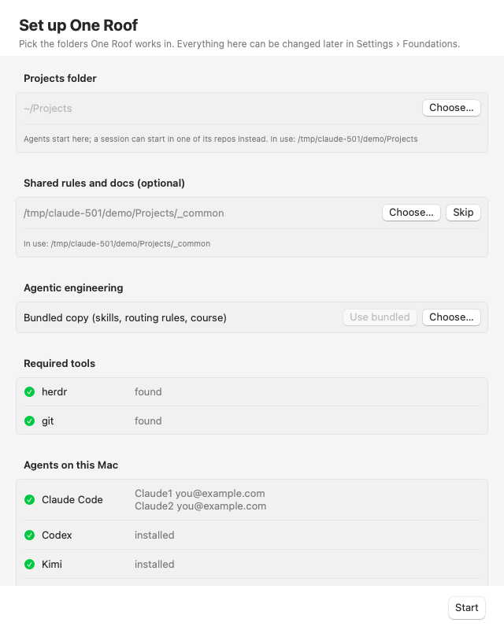

# One Roof help: getting started

**Status:** LIVE · **Date:** 2026-10-19

> **One line:** install One Roof, finish the first-run setup, and have your first agent session running in about five minutes; this page is also the index of every help page.

## Install

1. **Download** `One-Roof-<version>.zip` from the project's Releases page, unzip it, and move **One Roof.app** to Applications.
2. **Open it.** The app is signed with an Apple Developer ID and notarized by Apple, so it opens like any other app (macOS asks once to confirm it came from the internet).
3. **Or build from source:** see the [app README](../../app/README.md).

You also need:

- **At least one agent CLI, installed and signed in:** `claude` (Claude Code), `codex`, `kimi`, `gemini` (Gemini CLI) or `agy` (Antigravity). Sign in once from any terminal before you start.
- **Optional:** `brew install llama.cpp` for the small on-device routing model ([Seats and routing](07_seats-router-and-on-device-model.md)).

## First-run setup

On a fresh install One Roof opens a setup window. You can open it again any time with **One Roof › Setup…**, and change every answer later in Settings (⌘,).

| Step | What to choose |
|---|---|
| Projects folder | The folder that holds your repos. The default projects folder is `~/Projects` if it exists, otherwise your home folder. Agents start here. |
| Shared folder | Where your rules, handoffs and gotchas live. The default is `_common` inside your projects folder. **Create it** makes the folder for you. You can skip this step. |
| Agentic engineering folder | The skills, routing rules and course One Roof uses. The default is the copy bundled with the app. **Choose…** picks your own skills repo instead. |
| Agents detected | Which of `claude`, `codex`, `kimi`, `gemini` and `agy` are installed, and whether each is signed in. Nothing to do here except notice what is missing. |
| Linear API key | Optional. Only needed for the Work view and tickets ([Work and tickets](04_work-and-tickets.md)). It is saved to `~/.config/oneroof/linear-api-key`. |

## What One Roof is

One Roof is a Mac app that holds all your coding agents in one window. Each session is a real command-line agent (Claude, Codex, Kimi, Gemini CLI, Antigravity) or a plain shell. The agents run inside roofd, One Roof's own session manager; One Roof draws their terminals and shows each session's status, agent, account, repo and workstream. Quit One Roof and the agents keep running. Open it again and they are all still there.

- **Sessions panel (left):** every session in this window, live, grouped for you.
- **Centre:** the selected session's terminal, split into panes if you like, or one of the full views: Overview, Board, Decisions, Work, Learn, an objective, a file, or the review panel.
- **Plan panel (right):** the selected session's plan, ticket, notes and artifacts.
- **File browser:** the selected session's repo as a tree (hidden at first, ⌥⌘B).
- **Toolbar:** Workspace · Overview · Board · Decisions · Work · Learn, search (⌘K), the panel buttons (Sessions · Files · Plan) and **+ New session**.

## The startup check

Every time One Roof starts it checks that your agents are ready: roofd, logins, skills, the launch folder and more. The pill at the bottom of the sessions panel shows the result. Click it for details and Fix buttons ([Foundations](06_foundations.md)).

If something is red, launching an agent asks you to choose: **Open Foundations**, **Launch anyway** (lasts until you quit) or **Cancel**.

## Your first session

1. Press **⌘N** (File › New Session…).
2. In **What should happen**, type what you want done, for example `Add a dark mode toggle to settings`.
3. Leave the kind on **Just a session**.
4. Pick an **agent card** (for example Claude1), the **Repo** (for example `acme/web`) and, if you like, a **Model**.
5. Check the **Opening message**: the first prompt. One Roof sends it once the agent is ready, never while it is busy.
6. Leave **When** on **Now** and press **Launch** (⌘↩). The row shows Working, the terminal appears in the centre, and the opening message arrives a moment later.
7. When the agent stops to ask you something, the row turns **Needs you** and the Dock icon shows a badge. Click the row and answer in the terminal.

Agents start in your projects folder, so they all share one memory and one set of rules. Choose **Start in › Repo folder** to start inside the repo instead; Claude may then ask once to trust that folder.

## Also from the command line

- **Startup check:** `"/Applications/One Roof.app/Contents/MacOS/OneRoof" --check` prints the same check (exit 1 on red).
- **Linear connection:** `… OneRoof --linear` prints how many workstreams it found.
- **Routing:** `… OneRoof --route "<task>"` prints the kind of task and the agent the router would pick, with its reason.

## Every help page

| Page | What it covers |
|---|---|
| [Sessions](01_sessions.md) | The sessions panel: states, stickers, colours, pins, rename, the session menu, the plan panel, pop-out windows |
| [New session](02_planning-a-session.md) | The New session sheet: kinds, agent cards, models, roles, resuming a conversation, the start folder, When |
| [Objectives](03_objectives.md) | Write an objective, watch the planner, edit and approve the plan, follow the run |
| [Work and tickets](04_work-and-tickets.md) | The Work view, New work item, tickets and sessions both ways (needs Linear) |
| [Overview, Board, palette and shortcuts](05_launchpad-board-palette-and-shortcuts.md) | The overview pages, the command palette and a table of every keyboard shortcut |
| [Foundations](06_foundations.md) | What the startup check checks, why, and how to fix each item; Settings › Foundations |
| [Seats, router and on-device model](07_seats-router-and-on-device-model.md) | Seat gauges, how an agent is chosen, the reason line, rotation |
| [Themes, layout, viewer and find](08_themes-layout-viewer-and-find.md) | Themes per panel, opening and closing panels, file browser, viewer, find, links, text size |
| [Learn](09_learn.md) | The course, the skills and your own Learn folders inside One Roof; How do I…?; the player |
| [Review, split panes and session rows](10_review-split-panes-and-session-rows.md) | Review changes, split panes, branch and diff on rows, the unread dot, reopen a closed session |
| [Roof windows](11_roof-windows.md) | Every live session of one repo or workstream in its own window |

The Help menu inside One Roof opens these pages (One Roof Help), How Do I…?, the keyboard shortcuts, the release notes and the README.
