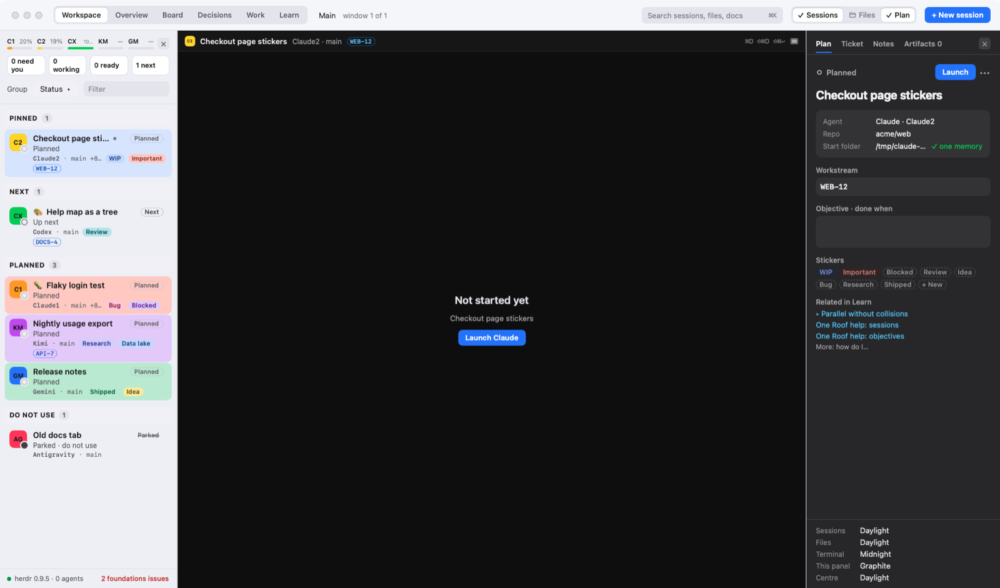
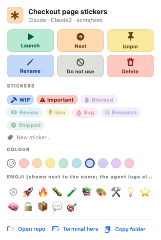

# One Roof help: sessions

**Status:** LIVE · **Date:** 2026-10-20

> **One line:** the sessions panel on the left shows every agent and terminal in this window with its live state, agent, account, repo and stickers; this page explains every part of it, the session menu, the plan panel and pop-out windows.

## Goal

You should be able to look at the left panel and know, without clicking, which agent needs you, which finished, which is still working and what each one is for. You never need to type prefixes like `WIP:` into a name: states come from the agents themselves (roofd), and labels are stickers.

## The states

| State | Where it comes from | What it means for you |
|---|---|---|
| Needs you | roofd (a prompt is waiting) | Stopped on a question or a permission prompt; it waits for you. Answer in its terminal, or in Decisions (⌘I). Counted on the Dock badge. |
| Working | roofd | Busy right now: thinking, running a tool or writing. Goes back to Ready or Idle a few seconds after it stops. |
| Ready | roofd | Finished a turn you have not looked at yet. Turns Idle as soon as you open the session or type in it. There is no timer. |
| Idle | roofd | Alive at its prompt with nothing new for you; not executing. Plain terminals are always Idle (they have no agent). |
| Next | One Roof | Planned and up next (When › Next, Mark as Next, or the Next sticker). |
| Planned | One Roof | Written ahead of time, not started. |
| Exited | One Roof | The agent's process has ended. Relaunch it, or remove it. |
| Parked (Do not use) | One Roof | Put aside by you. The name is struck through. |

The filter chips and the group headings use the same names: **Needs you · Working · Ready · Idle · Exited**. Hover a chip or a heading to see what it means.

Grouped by status, the panel lists them in that order (needs you first). Pinned sessions always sit in a Pinned group on top.

## Where sessions live (roofd)

Every session runs in **roofd**, One Roof's own session manager, which ships inside the app and runs in the background (macOS lists it under Login Items). One Roof draws the terminals; roofd keeps the programs.

| When | Your sessions |
|---|---|
| You quit, update or reopen One Roof | keep running; each terminal comes back with its screen and history |
| One session's process crashes | only that session ends (Exited, with Relaunch) |
| The Mac sleeps | keep running |
| You log out or restart the Mac | end; their rows stay, with Relaunch (Claude and Codex can resume the conversation) |

- **History:** each session keeps 8 MB of scrollback in memory. It is never written to disk, because agents print keys and file contents.
- **Status:** roofd reads each agent's screen (permission prompts, menus, spinners) and, for Claude, its hooks, so Working, Needs you and Ready stay right even with One Roof closed.
- **Tonight and Nightly** run with One Roof closed when Settings › Allow scheduled runs is on; roofd sends the opening message once the agent is ready.
- **Loops (Every 15 min … 4 h):** right-click a row › Repeat, or When › Every in the New session sheet. Each round, a session that is not running is launched; a running one gets its opening message (or objective) again, but only once the agent waits at its prompt: a round that finds it working or needing you waits, and is skipped after a whole interval. The row shows **⏱ next time · every 1 h**; Repeat › Stop Repeating ends it. Like Tonight, rounds run with the app closed when scheduled runs are allowed. An agent's own loop (Claude Code's `/loop`) also works inside any session, since roofd keeps the agent running.
- **Copy Attach Command** (right-click) gives `roofd attach <id>`: paste it into any terminal to see the same session there.

## Workspace windows

Each main window is a **workspace** with its own sessions. File › New Workspace Window… (⇧⌘N) opens another one; Window › Workspaces (⌥⌘1 to ⌥⌘9) switches between them; right-click a row › Move to Window moves a session. Closing a workspace window keeps its sessions. Closing any One Roof window (a workspace, a session in its own window, a roof window) first asks **Close …?**: tick **Yes, I'm sure** to enable Close; Cancel or Esc keeps it open. Overview, Board and Decisions show every window. Agents you start by typing their name in a One Roof terminal show that agent in their row; agents started in other terminal apps are not listed (Copy Attach Command opens a One Roof session from any terminal). Rows started outside One Roof.

## The top of the panel

- **Seat bars:** how much of each seat's usage window is used (Claude1, Claude2, Codex). They stay empty when there is no usage data. See [Seats and routing](07_seats-router-and-on-device-model.md).
- **Count chips:** All, **Needs you**, **Working**, **Ready**, **Idle** and **Exited** (agent sessions whose agent has ended; terminals are not counted), the same names as the group headings. Click one to show only that state; click **All** (or the same chip again) to get the full list back. Under **Exited**, *Remove all exited sessions* clears them. Next and planned sessions are under All.
- **Group ▾:** Status, Repo, Project, Agent, Account or Folder (also View › Group by, ⌘1 to ⌘6).
  - **Repo** is the git repo a session works in. Sessions start at the workspace root, which is not a repo, so One Roof learns the repo as the agent works: from the files Claude's tools touch and the folders its commands `cd` into, or from a terminal's current folder. It keeps the last one after the session ends. Until then the session is under **Workspace root · no repo yet** (last). Codex, Kimi, Gemini and Antigravity have no hooks, so they show their repo only when started in one.
  - **Folder** is the top-level folder under the workspace (one per product or area), for a coarser view.
- **Filter:** type to narrow the list; ✕ clears it.

## A session row

- **Agent logo** on the left, always the same for an agent (your emoji never replaces it), with a small **status dot**.
- **Pin**, the **unread dot** (new since you last looked, see [Review, split panes and session rows](10_review-split-panes-and-session-rows.md)), your **emoji** if you picked one, and the **name**. Double-click the name to rename it; Return saves, Esc cancels.
- **Second line:** the account (Claude1, Claude2) or the agent name, the repo, the time since it was last active, and a status pill when the list is not grouped by status.
- **Caption:** one line on what the session is doing right now, read from its terminal.
- **Third line:** the **branch and uncommitted change** chip (`⎇ main +34 −5`), **stickers**, the **Linear ticket** key and the **project** code.
- **Colour:** a row colour fills the whole row (Settings › Appearance › Fill rows with their colour).
- **Click** selects the session and shows its terminal. ⌘] and ⌘[ move to the next and previous row.
- **The selected row** (the session shown in the terminal) stands out: an accent outline and a bar down its left edge.

## The session menu

**Right-click a row** for the quick menu: Launch or Relaunch (not running) or Open (running: shows it in the main pane), Mark as Next / Mark as Planned (Next is scheduling: the one to do next), Do Not Use / Use Again, Pin / Unpin, every sticker as a tick box with its picture and what it means, Row Colour (a submenu of colour swatches), **Emoji, New Sticker and Rename…**, Move to Window, Open in New Window, Roof Window for the repo, Review Changes, Terminal Here, Show Folder in Finder, Copy Folder Path, Copy Link to Session, Copy Attach Command (running), Close Agent… (running) and Delete.

**••• on hover** opens the larger menu:

- **Action tiles:** Launch or Relaunch (not running) or Open (running: shows it in the main pane), Next / Not next (scheduling: the one to do next), Pin / Unpin, Rename, Do not use / Use again, and Close (running: ends the agent, after asking) or Delete (not running).
- **Stickers:** Next, WIP, Important, Blocked, Review, Idea, Bug, Research, Shipped, Do not use, or a word of your own (it keeps the same colour every time).
- **Colour** and **emoji** pickers.

Hover any tile or sticker to see what it does. Folder, terminal and window actions are in the right-click menu, not here.

Settings › Appearance switches stickers between Bold and Soft.

## The Session menu in the menu bar

Launch, Mark as Next, Mark as Planned, Do Not Use, Pin, Rename…, Move to Window, Schedule (Tonight 2:00 AM, Nightly at 2:00 AM, On Demand), Run Now, Interrupt (⌘.), Send Handoff, Open in New Window, Open Repo in Finder, Copy session id, Copy Working Directory, Copy Attach Command, Copy Link to Session, Close Agent…, Delete Session, Remove Exited Sessions…, Next Session (⌘]) and Previous Session (⌘[). Items that do not apply to the selected row are greyed out.

- **Close Agent** asks first. If the session has a ticket, a box (on by default) also comments a summary on the ticket and moves it to In Review. The conversation stays on disk and can be resumed later.
- **Delete Session** removes the row (and its notes and stickers). Sessions started outside One Roof cannot be deleted; they disappear when their agent ends.
- **Remove Exited Sessions** clears every exited row at once, except pinned ones.
- **Reopen Closed Session** (File menu, ⇧⌘T) brings back the last one you closed or deleted and launches it again.

## The plan panel (right, ⌥⌘P)

With a session selected it has four tabs:

- **Plan:** the state with **Launch** / **Relaunch**, the name, the **Project** (type a code, or pick one from the **Linear ▾** menu next to the box), **Objective · done when**, the plan steps when the session belongs to an objective, **Stickers**, **Related in Learn**, the **Opening message** (sent when the agent is ready), **Agent arguments** and the **Start folder**. **Save** (⌘S) keeps your edits; they are also saved when you select another row.
- **Ticket:** the linked Linear ticket with its live state and buttons, or how to link one.
- **Notes:** your own notes for this session.
- **Artifacts:** plan files, handoffs and screenshots for this session.

With nothing selected it shows today's counts and a short how-to. The **Appearance** box at the bottom sets the theme of each panel ([Themes and layout](08_themes-layout-viewer-and-find.md)).

## Steps: rewind and explain

The top of a running agent's pane lists its **steps**: each prompt you gave it (and each "Step n" in a plan it follows).

- **Capped:** the list shows six steps; more scroll inside it, and it keeps the current step in view.
- **Rewind:** click a step to scroll the terminal back to where it started, then scroll on from there. The pane shows **Viewing step n**; **Back to current** (or the **Current** button above the steps, or clicking the same step again) returns to the live bottom.
- **Step review (right panel, off until you switch it on):** each step it reviews is one more Claude call, so the box has its own switch (also in Settings › Captions). On, the Plan tab shows a **Step review** of the latest finished step, without a click: Claude (Haiku, run with no tools and nothing saved, on the session's Claude account) reads that step and says **what was asked**, **what happened**, the **decisions** and the **risks**, in a small scrolling box. Click a step above the terminal and the review follows it (marked *selected*; **Latest** goes back). ↻ reads it again. It reads only the terminal text, so check anything that matters.

The steps cover the session's last 5,000 lines; an older step can no longer be rewound to or explained.

## A session in its own window

Session › Open in New Window (⌥⌘O), or New window in the session menu, moves a running session's terminal into its own window. The centre then says "Open in its own window" with **Show window** and **Bring back here**.

## The footer

The bottom of the panel shows the startup check: a count of foundations issues, or "Checking…". Click it to open Foundations. If One Roof cannot reach roofd, see [Foundations](06_foundations.md).
