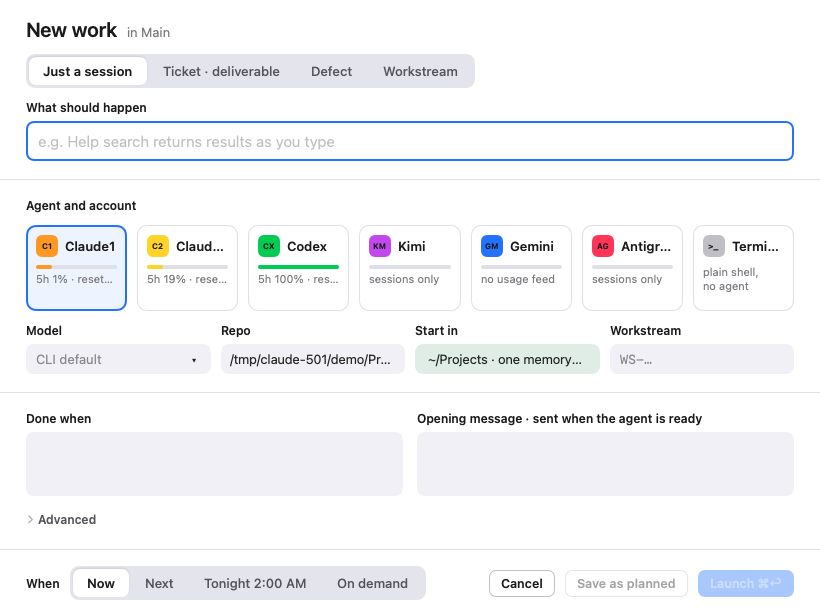

# One Roof help: starting a new session

**Status:** LIVE · **Date:** 2026-10-20

> **One line:** ⌘N opens the New session sheet, where you say what should happen, pick the Linear issue it works on (or none), an agent card, model, repo and start folder, write the opening message, and choose when it runs: now, next, tonight or on demand.

## Goal

A session is described before it starts, so you can line up work ahead of time and the sidebar always says what each agent is for. Launching then needs one click, and the opening message is sent only once the agent is ready.

## Open the sheet

- **⌘N**, File › New Session…, **+ New session** in the toolbar, or "Plan a session" in the command palette (⌘K).
- From a Linear ticket in the Work view (the play button), One Roof fills the session from the ticket ([Work and tickets](04_work-and-tickets.md)).

## Session first

The sheet is for starting a session. Most of the time the work already exists in Linear: you pick it and launch. Creating a new issue or project is the last item of a menu, for when the work is not in Linear yet.

## Team, project and issue

When Linear is connected, the row under the title has three pickers: **Team ▾ · Project ▾ · Issue ▾**. All three are optional for a plain session.

| Picker | What it does |
|---|---|
| Team ▾ | Limits the Project list to that team's projects. |
| Project ▾ | The project the session belongs to. Picking a project sets its team. |
| Issue ▾ | The project's open issues, newest first. Pick one and the session works on it. **No issue** means a plain session. |

- **Picking an issue** links the session to it, the same as **Plan a session for…** on a ticket. The opening message names the issue key (for example `ENG-42`) and how to name commits.
- **What should happen** can be typed after picking an issue; the issue stays picked. Leave it empty and the session takes the issue's title.
- The last team and project you used are remembered.

Without Linear connected there is no picker row. A free-text **Project** field takes the project code (`CODE-…`) instead.

## When the work is not in Linear yet

The last item of each menu creates something, then starts the session on it.

**A new issue:** the bottom of Issue ▾, under **New issue**: **New deliverable…**, **New bug…**, **New task…**, **New spike…** or **New decision…**. Long issue and project titles in the menus end in "…" so the menus stay narrow.

- The issue is created in the picked project, or in the team only when no project is picked. A team is required.
- It gets that Type label in Linear. Older workspaces that use `type:*` labels still work. The title is used as you typed it; only projects in the older `WS-…` style also get a `[ws-…]` prefix.
- If an issue with a similar title already exists, a **Similar ticket** banner offers **Plan a session for ENG-42 instead**.
- The button says **Create issue, launch ⌘↩**.

**A new project:** Project ▾ › **New project…**. Two more fields appear:

| Field | What to put there | Example |
|---|---|---|
| Code | Optional. The project's code, in the TEAM-TOPIC shape; One Roof checks the shape. | `ENG-CHECKOUT` |
| Milestones | Comma separated, in order. | `Design, Build, Ship` |

**Create project, launch ⌘↩** creates the project in Linear, named "CODE · title" (for example `ENG-CHECKOUT · New checkout`), in state **Planned**, with those milestones. It then plans a Claude session that writes the project's docs folder (README, STATUS), adds the first tickets and posts a first project update.

## The fields

| Field | What to put there |
|---|---|
| What should happen | What you want done, in your words. It becomes the session's name. Empty with an issue picked: the issue's title. A project code in it (like `ENG-KNOW-03`) fills Project for you. |
| Agent and account | One card per agent: Claude1, Claude2 (only when you have a second Claude config), Codex, Kimi, Gemini, Antigravity, and Terminal (a plain shell, no agent). Each card shows its seat use when known. **Suggested:** names the router's pick and why; **Use it** selects it. |
| Model | Passed to the CLI as `--model <name>`. Claude: opus, sonnet, haiku; any name works. Empty means the CLI's default. |
| Repo | The repo the session works on, or your projects folder itself. It decides the repo label, the file browser and the branch chip. |
| Start in | **Projects folder · one memory** (the default) or **Repo folder**. In the repo folder, Claude may ask once to trust it, and its memory is kept separately from your projects folder. |
| Done when | What finished looks like. Shown in the plan panel. |
| Opening message | The first prompt. One Roof sends it once the agent is at its prompt and idle, and never twice, even across restarts. With an issue picked it says which issue to work on and how to name commits. |

**Advanced** holds:

- **Agent arguments:** extra CLI arguments, for example `--permission-mode plan`.
- **Role:** a skill plus the agent that runs it (for example a second-opinion review on Codex), read from `roles.json` in your agentic engineering folder. Picking one fills agent, model, name and opening message.
- **Resume a Claude conversation:** lists your recent Claude conversations by title. Pick one to continue it in One Roof. If it was active in the last few minutes, One Roof warns you to close it in the other terminal first, so two Claudes do not write to one conversation.
- **Own git worktree:** shown but not available yet.

Defaults for account, model and arguments come from Settings › Agents (⌘,), per agent.

## When

| When | The button says | What happens |
|---|---|---|
| Now | Launch ⌘↩ | Starts the agent right away and selects it. |
| Next | Save as next ⌘↩ | Saves it as Next, ready for one click. |
| Tonight 2:00 AM (▾ Nightly) | Save for tonight ⌘↩ | Schedules it. Scheduled sessions start while One Roof is open; missed runs are reported. |
| Every 1 h (▾ 15 min … 4 h) | Launch, repeat every 1 h ⌘↩ | A loop: starts now, then sends the opening message again every interval when the agent is waiting at its prompt (never while it works or needs you). |
| On demand | Save on demand ⌘↩ | Saves it as Planned. |

When you are creating an issue or a project, the button says **Create issue, launch ⌘↩** or **Create project, launch ⌘↩**, and **Create issue, next ⌘↩** or **Create project, next ⌘↩** for Next.

**Save as planned** keeps it as a planned row whatever When says. **Cancel** (Esc) closes the sheet. Launch a planned session later with the Launch button in the centre or the plan panel, the session menu, or ⌘↩.

## What happens at launch

1. One Roof checks the startup check is not red (or you chose Launch anyway).
2. roofd starts the CLI through your login shell with your agent, account and model, in your projects folder or the repo; the opening message follows once the agent is ready, even with One Roof closed.
3. The terminal appears in the centre (or in the focused pane, if the centre is split).
4. When the agent is ready and idle, the opening message is typed in and sent. One Roof never types into a busy or blocked agent.
5. If the session has a Linear issue, the issue moves to In Progress.

## Safety built in

- **Only inside your projects folder:** agents start in the projects folder or one of its repos, never anywhere else. The kit (`roof install`) can enforce the launch folder for agents you start outside One Roof too.
- **Accounts are read from the running process,** so Claude1 and Claude2 are labelled right however the agent was started. Claude1 uses your default Claude config (`~/.claude`) and never sets `CLAUDE_CONFIG_DIR`.
- **Accounts never leak between sessions:** each session starts with only the account variables its own launch sets.
