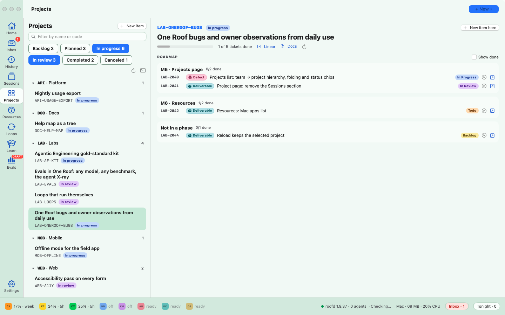

# One Roof help: work and tickets

**Status:** LIVE · **Date:** 2026-10-20

> **One line:** the Work view (⇧⌘W) shows every project from Linear with its milestones, tickets and sessions; New work item (⌃⌘N) decides what a piece of work is before creating it; and tickets and sessions update each other. All of this is optional and needs a Linear API key.

## Goal

Each tool owns one thing: Linear owns **projects** and **tickets**, One Roof owns **sessions** and is where work starts. You should never have to copy a ticket into a session by hand, or remember to move a ticket when a session starts or ends.

## Connect Linear

The Work view and tickets are optional. Without Linear, the rest of One Roof works the same, and the Work view explains how to connect.

- **The key:** a Linear personal API key, in the `LINEAR_API_KEY` environment variable or in `~/.config/oneroof/linear-api-key`. The first-run setup (One Roof › Setup…) can save it there for you. One Roof never shows the key.
- **Check the connection:** `OneRoof --linear` in a terminal prints your teams and how many projects it found, with each project's code.
- **Test a full round trip:** `OneRoof --linear --linear-roundtrip <TEAM>` (for example `ENG`) creates a test project with two milestones and a Bug ticket, prints what Linear stored, then deletes both (they go to Linear's trash).
- **Limits:** up to 150 tickets per project and 20 milestones are fetched.

## Three words, with examples

| Word | What it is | Example |
|---|---|---|
| Project | An outcome that needs several sessions and more than one deliverable. A Linear project (any project in your workspace). | `ENG-CHECKOUT · New checkout` |
| Ticket | One deliverable, defect, spike, decision or chore, in a Linear team and usually in a project. | `ENG-42`, the payment form |
| Session | One agent run, usually on one ticket. | "Payment form" on Claude1, linked to ENG-42 |

## The Work view

Open it with **⇧⌘W** (View › Work: Projects and Roadmap), **Work** in the toolbar, or the palette.

- **Left:** every Linear project, grouped by team, with its state and a count of live sessions. Type in **Filter projects** to narrow them, tick **Show shipped**, reload from Linear, or go back to the terminals.
- **Right, for the selected project:** its name and state, "12 of 20 tickets done", links to **Linear**, the **Tracker pane** and the **Docs** folder when they exist, then **Sessions** (the sessions working on it) and the **Roadmap**: each milestone with its open tickets (tick **Show done** for all).
- **On each ticket:** its key, type (Deliverable, Defect, Spike, Decision, Chore), title, a state pill you can click to change the state in Linear, a play button to **plan a session** for it, a link to its session if one exists, and a link to Linear.

**Tracker pane and Docs are optional.** The Tracker pane link appears when a `_MASTER-TRACKER.html` file in your projects folder, one of its subfolders or your shared folder has a section for the project. The Docs link appears when a `docs/projects/<code>/` or `docs/workstreams/<id>/` folder exists for it, in your shared folder, at the root of a `*-docs` repo, or in a repo's `docs/`.

## From a ticket to a session

1. Press the play button on a ticket, or pick it under **Issue ▾** in the New session sheet (⌘N). One Roof plans a session with the ticket key, the project, and an opening message that says to work on that ticket and commit as `ENG-42 · [eng-checkout] …`.
2. Launch it. The ticket moves to **In Progress** in Linear.
3. The row shows the ticket key, and the plan panel's **Ticket** tab shows the live state with buttons **In Progress**, **In Review** and **Done**.
4. When you close the agent (Close Agent…), a box (on by default) posts a summary comment to the ticket (agent, seat, run time, newest handoff for the project, your notes) and moves it to **In Review**. Committing from the review panel can do the same ([Review](10_review-split-panes-and-session-rows.md)).

## One session, several issues

A session can work on more than one issue, including ones that come in while it runs.

- **Add an issue:** **Issue…** (or **Add issue…**) in the session menu, **Add Issue…** on right-click, or **Add issue…** on the plan panel's **Ticket** tab. Pick an open issue or create one. An issue already on the session is not added twice.
- **Telling the agent:** with **Tell the agent** on, the agent gets a message naming the issue and how to commit for it. If the agent is working, the message waits and is sent the moment it is back at its prompt (it survives a restart).
- **What you see:** the row shows `KEY +N`; the **Ticket** tab lists each issue with its state and an ✕ to take it off the session. A running session's new issue moves to **In Progress**.
- **On commit:** when a commit made after launch names one of the session's issues (`ENG-42 · …`), that issue moves to **In Review** once, with the commit in a comment.
- **On close:** Close Agent… shows one box per issue, so you choose which ones move to **In Review**.

## New work item: decide what it is first

Press **⌃⌘N** (File › New Work Item…), **New item** in the Work view, or **+ New work item** on the Overview. The New session sheet (⌘N) can also create an issue or a project, as the last item of its **Issue ▾** and **Project ▾** menus, and then starts the session on it ([New session](02_planning-a-session.md#when-the-work-is-not-in-linear-yet)).

1. Say what you want done ("Login fails on Safari") and optional details.
2. Tick "It needs several sessions and more than one deliverable" if it is bigger than a ticket.
3. One Roof suggests **what it is** (project, deliverable, defect, spike, decision, chore, or just a session) and **which project** it belongs to. You can change both.
4. If a ticket with a similar title already exists, it says "Looks like an existing ticket. Use it instead?" with **Plan a session for it**.
5. Create it: the ticket is made in Linear (Backlog, with its Type label: Deliverable, Bug, Task, Spike or Decision), and "Plan a session for it now" plans the session in the same step.

A **new project**, with Linear connected, is created straight in Linear (named "CODE · title", state Planned, with the milestones you list), and then One Roof plans a Claude session that writes its docs folder, adds the first tickets and posts a first project update. Without Linear, the Claude session does every step. See [When the work is not in Linear yet](02_planning-a-session.md#when-the-work-is-not-in-linear-yet).

## Which Linear projects and codes

One Roof reads **every** project in your Linear workspace.

- **A project's code** is the part of its name before " · ", when that part looks like an id: TEAM-TOPIC or TEAM-TOPIC-NN. `ENG-CHECKOUT · New checkout` has the code `ENG-CHECKOUT`; `ENG-KNOW-03 · Knowledge v3` has `ENG-KNOW-03`. Older names that start with `WS-` still work.
- **In free text** (session names, commit tags) One Roof recognises `WS-…` ids, commit tags like `[eng-know-03]`, and bare upper-case codes like `ENG-KNOW-03`.
- **Issue keys** like `ENG-42` are never read as projects.
