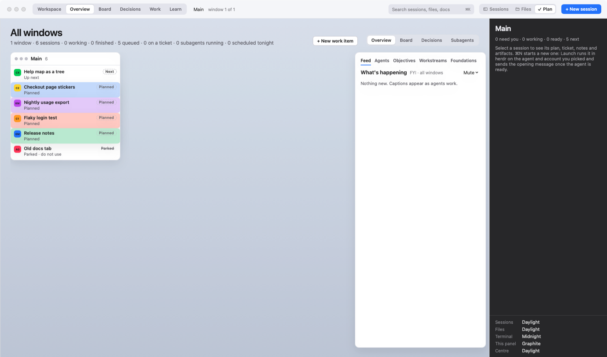
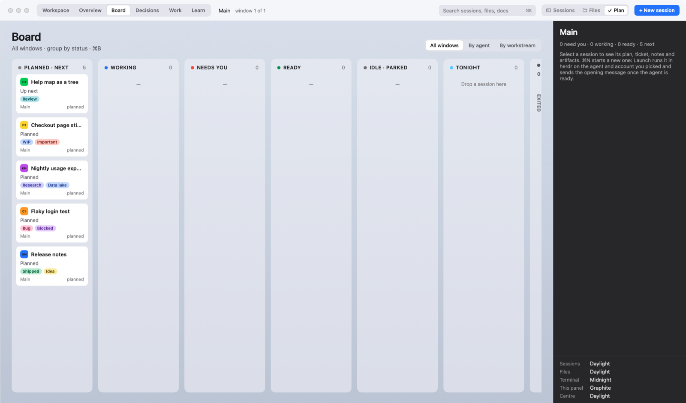
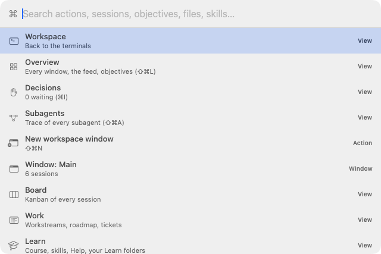

# One Roof help: Overview, Board, Decisions, command palette and keyboard shortcuts

**Status:** LIVE · **Date:** 2026-10-19

> **One line:** the Overview is one page of all your work, the Board is a Kanban of every session, Decisions lists every agent waiting on you, the command palette (⌘K) finds anything, and the table at the end lists every keyboard shortcut in One Roof.

## Overview (⇧⌘L)

One page that answers "what needs me, and what is going on?" across every window. Open it with **⇧⌘L** (View › Overview), **Overview** in the toolbar, or Window › All Windows (⌃↑, if macOS Mission Control does not already use that key).

- **Windows:** one card per workspace window with its sessions and how many need you.
- **What's happening:** a feed of what agents in all windows are doing, from their captions.
- **Objectives:** open objectives with their progress, or "Plan ready" when a plan waits for approval; **+ New objective**.
- **Agents at work:** live sessions per account (Claude1, Claude2, Kimi…).
- **Seats:** Claude1, Claude2 and Codex use of the 5-hour and 7-day windows, with reset times, when usage data exists ([Seats and routing](07_seats-router-and-on-device-model.md)). Kimi and Antigravity publish no usage, so One Roof counts their sessions.
- **Just finished:** results you have not looked at yet.
- **Foundations:** the startup check in one line; **Open Foundations** when something is wrong.
- **+ New work item** at the top.

## Board (⌘B)

A Kanban of every session in every window, left to right: **Planned · Next → Working → Needs you → Ready → Idle · Parked → Tonight → Exited → Do not use**. Drag a card onto Planned · Next, Tonight or Do not use to change it; the other columns follow the agents' live state. The Tonight column has **Schedule** with a time and an **Every night** switch. Exited and Do not use can be collapsed. Double-click a card to open that session. ⌘B again closes the Board.

## Decisions (⌘I)

Every agent that is waiting on you, in one list: its question in its own words, what the command would touch, the risk and what happens if you say no. **Allow once** (Return), **Always allow** (for that command in that repo), **Deny** (Esc) and a typed reply send the agent's own keys, exactly as if you had typed them in its terminal. Plans waiting for your approval are listed here too. The toolbar shows how many decisions are open.

## Subagents (⇧⌘A)

A timeline of the subagents a Claude session started, read from its conversation transcript. A session whose transcript cannot be matched shows no subagents rather than a guess.

## Command palette (⌘K)

Press **⌘K** (⌘P works too), or click the search box in the toolbar, and type a few letters. It searches:

- **Views:** Workspace (back to the terminals), Overview, Decisions, Subagents, Board, Work, Learn, Foundations, Settings.
- **Windows:** every workspace window, and New workspace window.
- **Actions:** plan a session, new terminal, new objective, new work item, find in terminal, search in workspace, toggle each panel, review changes, split right or down, close or maximize a pane, even out panes, reopen a closed session, run the startup check, remove exited sessions, open the selected session in a new window, roof windows, How do I…?
- **Themes:** set all panels to one theme.
- **Sessions, objectives and workstreams** by name.
- **Files** tracked in the selected session's repo (up to 4,000), which open in the viewer.
- **Skills**, which open their Learn page.

Letters can be spread out ("rvch" finds Review changes); runs of letters and word starts rank higher. **↑ / ↓** move, **Return** runs the item, clicking elsewhere closes the palette.

## Every keyboard shortcut

All of these are in the menu bar too. Settings › Shortcuts lets you change any of them.

| Shortcut | Menu | Does |
|---|---|---|
| ⌘, | One Roof › Settings… | Settings |
| (none) | One Roof › Setup… | The first-run setup again |
| ⇧⌘F | One Roof › Foundations… | The startup check, skills, hooks, memory |
| ⌘K (or ⌘P) | One Roof › Command Palette… | Find views, actions, sessions, files, skills |
| ⌘H / ⌥⌘H | One Roof › Hide One Roof / Hide Others | Hide the app, or the other apps |
| ⌘Q | One Roof › Quit One Roof | Quit (agents keep running in roofd) |
| ⌘N | File › New Session… | Start or plan a new session |
| ⌘T | File › New Terminal | A plain shell in your projects folder |
| ⌃⌘T | File › New Terminal in Selected Repo | A plain shell in the selected session's repo |
| ⇧⌘N | File › New Workspace Window… | A new workspace window with its own sessions |
| ⌥⌘N | File › New Roof Window for Selected Repo | Every live session of that repo in its own window ([page 11](11_roof-windows.md)) |
| ⇧⌘O | File › New Objective… | Write an objective |
| ⌃⌘N | File › New Work Item… | Decide what a piece of work is, then create it |
| ⌘O | File › Open File… | Open a file in the viewer |
| ⌘S | File › Save | Save the open file, or the session's edits in the plan panel |
| ⌘↩ | File › Launch Selected Session | Launch the selected planned or exited session |
| ⌘W | File › Close Session… | Close the selected session (asks if it is running) |
| ⇧⌘T (or ⌥⌘T) | File › Reopen Closed Session | Bring back and relaunch the last closed session |
| ⌥⌘O | File › Open in New Window | Move a running session into its own window |
| ⌃⌘W | File › Close Window | Close the window (agents keep running in roofd) |
| ⌘Z / ⇧⌘Z | Edit › Undo / Redo | Undo and redo in text fields |
| ⌘X / ⌘C / ⌘V / ⌘A | Edit › Cut / Copy / Paste / Select All | Text editing and terminal copy and paste |
| ⌥⌘K | Edit › Clear Terminal | Clear the focused terminal |
| ⌘F | Edit › Find… | Find in the focused terminal |
| ⌘G / ⇧⌘G | Edit › Find Next / Find Previous | Next or previous match |
| ⇧⌘S | Edit › Find in Workspace | Search across your repos |
| ⌘1 … ⌘5 | View › Group by Status, Repo, Workstream, Agent, Account | Group the sessions panel |
| ⇧⌘L | View › Overview | One page of all work |
| ⌘B | View › Board | Kanban of every session |
| ⌘I | View › Decisions | Every agent waiting on you |
| ⇧⌘A | View › Subagents | Timeline of Claude subagents |
| ⇧⌘E | View › Learn | The course, skills and your Learn folders |
| ⇧⌘W | View › Work: Workstreams and Roadmap | Workstreams, phases, tickets |
| ⌘+ / ⌘− / ⌘0 | View › Bigger Text / Smaller Text / Actual Size | Text size |
| ⌥⌘S | View › Toggle Sidebar | Show or hide the sessions panel |
| ⌥⌘P | View › Toggle Plan Panel | Show or hide the plan panel |
| ⌥⌘C | View › Centre Panel | Show or hide the centre |
| ⌥⌘B | View › File Browser | Show or hide the file browser |
| ⌥⌘R | View › Review Changes | Review the selected session's uncommitted changes |
| ⌘D | View › Split Right | Split the focused pane, new pane on the right |
| ⇧⌘D | View › Split Down | Split the focused pane, new pane below |
| ⌥⌘W | View › Close Pane | Close the focused pane (the session keeps running) |
| ⇧⌘↩ | View › Maximize Pane | Show only the focused pane; again to show all |
| (none) | View › Even Out Panes | Every split back to half and half |
| ⌥⌘← ⌥⌘→ ⌥⌘↑ ⌥⌘↓ | View › Focus Pane Left / Right / Up / Down | Move focus to the next pane |
| ⌥⌘F | View › Focus: Terminal Only | Hide both side panels; again to bring them back |
| ⌘L | View › Focus Terminal | Leave the Overview, Board, Work, Learn or an objective and type in the terminal |
| ⌘R / ⇧⌘R | View › Raw Stream / Run, Debug | In a session: its raw output; in the editor: run or debug the file |
| ⌘. | Session › Interrupt | Interrupt the selected agent |
| ⌘] / ⌘[ | Session › Next Session / Previous Session | Move down or up the sessions panel |
| ⌘M | Window › Minimize | Minimize the window |
| ⌃↑ | Window › All Windows | The Overview |
| ⌥⌘1 … ⌥⌘9 | Window › Workspaces | Go to workspace window 1 to 9 |
| ⌥⌘/ | Help › How Do I…? | Ask Learn a question ([page 09](09_learn.md)) |

Without a shortcut, in the menus: Run Startup Check (One Roof menu); Ask Agent About Selection (Edit); the panel theme menus and Search in Workspace (View); Launch, Mark as Next, Mark as Planned, Do Not Use, Pin, Rename…, Move to Window, Schedule, Run Now, Send Handoff, Open Repo in Finder, Copy session id, Copy Working Directory, Copy Attach Command, Copy Link to Session, Close Agent…, Delete Session, Remove Exited Sessions… (Session); Zoom, Roof Windows, Foundations and Bring All to Front (Window); One Roof Help, Keyboard Shortcuts, Release Notes and the README (Help).

### Keys inside a view

| Where | Key | Does |
|---|---|---|
| New session sheet | ⌘↩ / Esc | The main button (Launch, Save as next…) / Cancel |
| Plan panel | ⌘S | Save the session's edits |
| Session name in the sidebar | double-click, then Return / Esc | Rename / cancel |
| Find bar | Return / ⇧Return / Esc | Next match / previous match / close |
| Command palette | ↑ ↓, Return | Move, run |
| Review comment box | ⌘↩ | Send the comment to the agent |
| Review panel | ⌘↩ / ⌥⌘D | Commit / side-by-side diff on or off |
| Decisions | Return / Esc / ⌘] ⌘[ | Allow once / Deny / next or previous decision |
| Terminal | ⌘-click a link | Files open in the viewer, web links in the browser |
