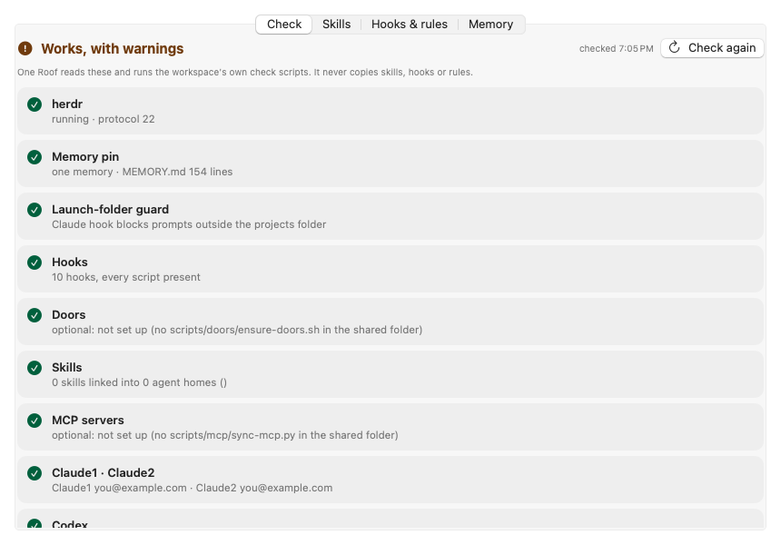
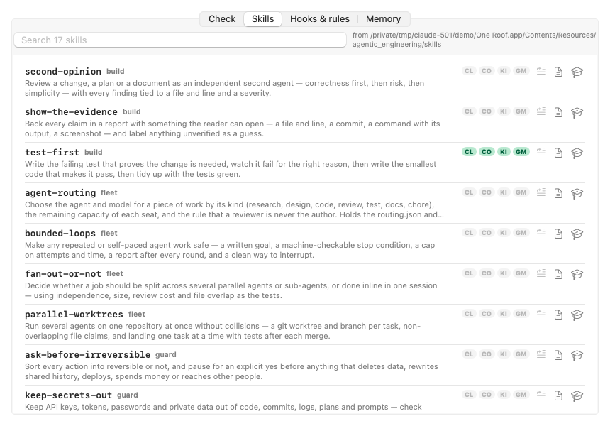

# One Roof help: Foundations and the startup check

**Status:** LIVE · **Date:** 2026-10-20

> **One line:** at every launch One Roof checks that each agent can see the same rules, skills, hooks, memory and logins, by reading them where they live and running their own check scripts; this page says what each check means, why it matters and how to fix it, and covers Settings › Foundations.

## Goal

Every agent you start should see the same rules, skills, hooks and memory. If a link is missing, an agent works without them and you only notice later. One Roof never copies these things: it reads them where they live and runs their own check scripts, so the check is exactly as strict as the scripts.

## Where to see it

- **Sidebar footer:** the count of foundations issues. Click it.
- **One Roof › Foundations… (⇧⌘F)**, or Window › Foundations. **Check again** inside the window; One Roof › Run Startup Check runs it from the menu.
- **Overview:** one line under Foundations.
- **Terminal:** `OneRoof --check` prints the same list (exit 1 when anything is red).
- **Settings › General:** "Check the foundations every time One Roof starts" (on by default).

## What red does

Launching an agent while a check is red shows a choice: **Open Foundations**, **Launch anyway** (until One Roof quits) or **Cancel**. One Roof runs the check again first, and when every red check has a fix it offers **Fix and launch**, which runs the fixes and then launches. Running objectives pause with a message. Amber never blocks.

## Each check

| Check | Why it matters | Red or amber when | How to fix |
|---|---|---|---|
| roofd | Every session runs in roofd, One Roof's session manager, which ships inside the app. | Red: roofd does not answer and cannot be started. Amber: an unexpected protocol version. | One Roof starts it on its own; Fix starts it again. |
| roofd background item | macOS starts roofd at login and restarts it if it stops (System Settings › General › Login Items › One Roof). | Amber: waiting for your approval in Login Items, or not registered; One Roof then starts roofd itself while it runs. | Fix opens Login Items. |
| Memory pin | Claude keys its memory on the launch folder. The pin makes every Claude session share one memory, the one for your projects folder. | Red: `autoMemoryDirectory` is missing from `~/.claude/settings.json`, or points elsewhere. Amber: `MEMORY.md` is missing, or over 200 lines (only the first 200 load). | Run `roof install` from the kit, or set `autoMemoryDirectory` yourself. Trim the index. |
| Launch-folder guard | A Claude hook stops prompts while a session is outside your projects folder. | Red: no `UserPromptSubmit` hook in `~/.claude/settings.json`. | Run `roof install` from the kit, or add your own hook. |
| Hooks | Each Claude hook points at a script. | Amber: a hook's script file is missing. | Restore the script (its name is in the detail line). |
| Doors | A door is a small file under the name an agent looks for (`AGENTS.md`, `GEMINI.md`…) that points at your one rulebook, so every agent finds the rules from any folder it starts in. | Uses `scripts/doors/ensure-doors.sh` in your shared folder. Red: the script's check fails. Amber: the script is not there. | Fix runs the script. Without the script, ignore it. |
| Skills | The skills in your agentic engineering folder must be linked into every agent's skills folder. | Red: a link is missing or stale (from `scripts/sync-skills.sh --dry-run`). | Fix runs `scripts/sync-skills.sh` from your agentic engineering folder. |
| MCP servers | One MCP server list for all agents. | Uses `scripts/mcp/sync-mcp.py` in your shared folder. Red: its check fails. Amber: the script, or a recent enough Python, is not there. | Fix runs the script, or `brew install python@3.12`. Without the script, ignore it. |
| Agents | Each agent CLI (`claude`, `codex`, `kimi`, `gemini`, `agy`) is installed and signed in. Claude2 is checked only if you have a second Claude config. | Amber: not on your PATH, or no login found. | Install or sign in to that CLI from a terminal. |
| Agentic engineering | Skills, roles, routing rules and the course are read from this folder. | Red: the folder is missing. | Choose another folder, or **Use bundled**, in Settings › Foundations. |
| On-device router model | Suggestions use it to sort a task into a kind. | Amber: `llama-server` or the model file is missing, or the model is still Arch-Router (its licence restricts commercial use). | Fix runs `brew install llama.cpp`; **Get the model** on the row downloads and checks the model (also in Settings; [Seats and routing](07_seats-router-and-on-device-model.md)). Without it, routing uses the rules alone. |

**Fix** buttons open a plain One Roof terminal in your projects folder and run the command there, so you see what it does. One Roof never fixes anything silently.

## The other tabs

- **Skills:** every skill in your agentic engineering folder, searchable, with its group and description and which agent skill folders have it (CL, CO, KI, GM). Per skill: type `/name` into the selected session (not sent), open its `SKILL.md`, or open it in Learn.
- **Hooks & rules:** the rules every agent reads, and every Claude hook with its event, matcher and script. Codex, Kimi and Antigravity have no hooks; the kit reaches them through PATH stand-ins and the doors.
- **Memory:** **Latest handoff per project** from `docs/next-session-handoff/` in your shared folder (**Resume** plans a Claude session that reads it and continues), recent gotchas from `docs/gotchas/`, and `MEMORY.md`. Empty when you have no shared folder.

## Settings › Foundations

The folders One Roof reads. It only reads them; skills, hooks and routing rules are never copied into One Roof.

| Setting | What it is | Override |
|---|---|---|
| Projects folder | The folder that holds your repos. Agents start here. | `ONEROOF_PROJECTS` |
| Agentic engineering | **Choose…** your own skills repo, **Use bundled** to go back to the copy inside the app, **Show** to open it in Finder. The **In use:** line says which folder is active and why. A chosen folder that disappears falls back to the bundled copy. | `ONEROOF_AE_PATH` |
| Shared folder | Your rules, handoffs and gotchas (default `_common` in your projects folder). | `ONEROOF_SHARED` |
| Learn folders | Extra folders shown in Learn: any folder of Markdown pages, and folders of narration clips. **Add…** and **Remove**. | |
| On-device model | The path of the routing model file. | |

An environment variable, when set, wins over the setting. The first-run setup (One Roof › Setup…) asks for the first three.
