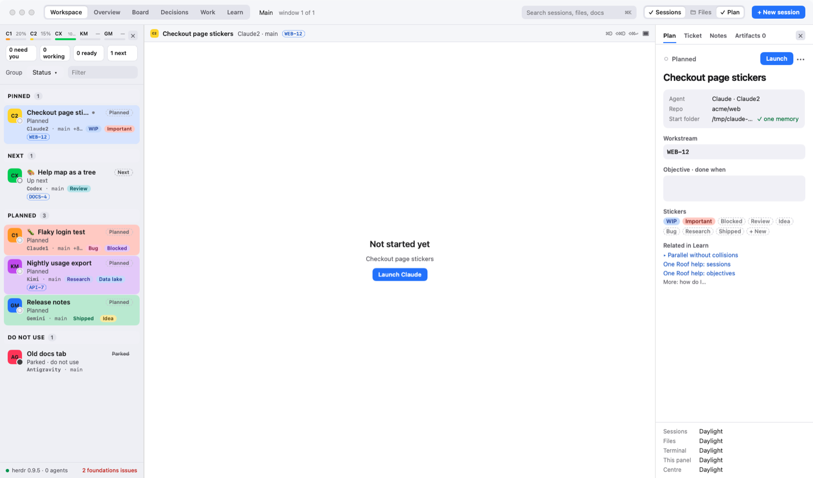
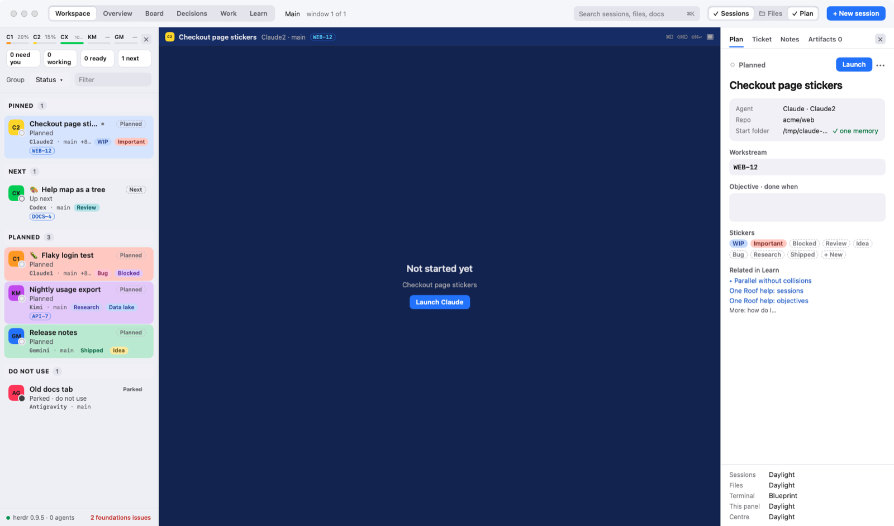
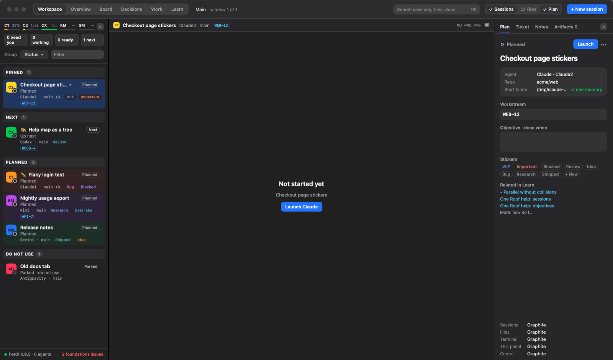
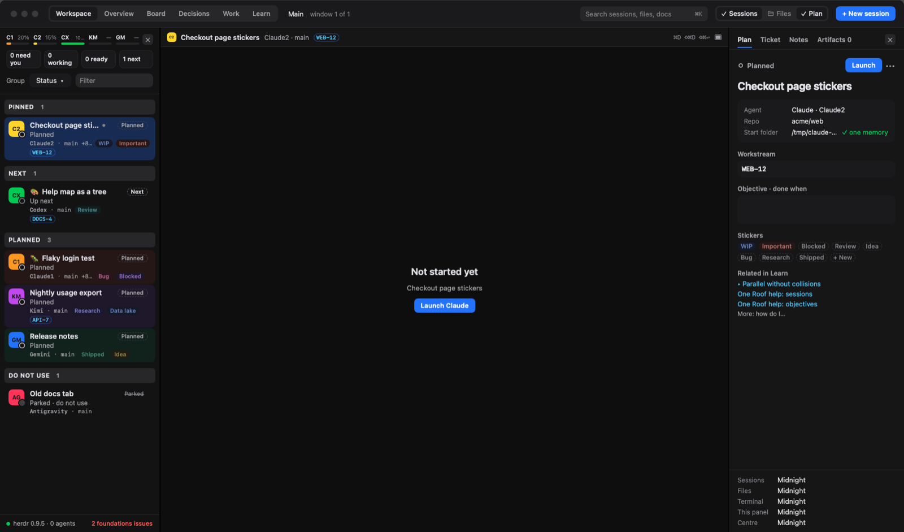
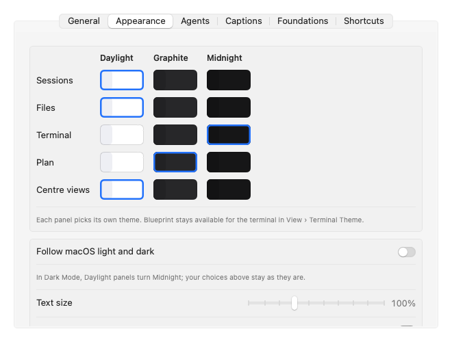
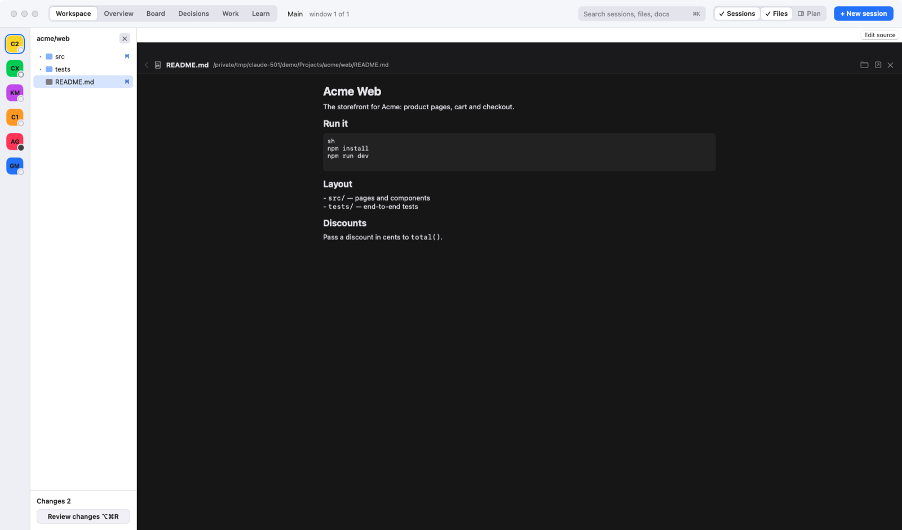
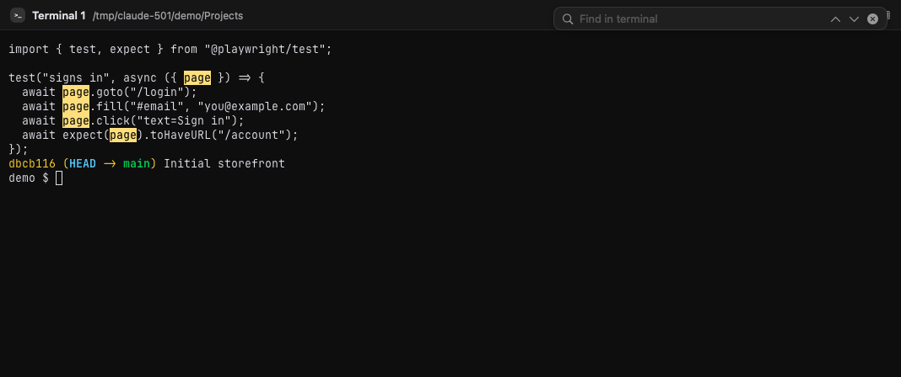

# One Roof help: themes, layout, editor, viewer and find

**Status:** LIVE · **Date:** 2026-10-19

> **One line:** three themes chosen per panel (plus Blueprint for the terminal), panels you can open and close, a file browser, an editor for code and a viewer for Markdown, images and HTML, find in the terminal, clickable links, text size and pop-out windows.

## Goal

The window should look the way you like and hold only what you need right now: a light sessions panel next to a dark terminal, the terminal alone when you focus, a file or a plan open in the middle without leaving One Roof.

## Themes, panel by panel

| Daylight | Daylight panels, Blueprint terminal | Graphite | Midnight |
|---|---|---|---|
|  |  |  |  |

- **Themes:** Daylight (light), Graphite (dim) and Midnight (dark) for every panel. The terminal can also use Blueprint.
- **Panels, each with its own theme:** sessions, file browser, terminal, plan panel and the centre views.
- **Where to change them:** Settings › Appearance (⌘,), the Appearance box at the bottom of the plan panel, View › Sessions Panel / File Browser / Terminal / Plan Panel / Centre Views Theme, or "Theme: all panels …" in the command palette.
- **Follow macOS light and dark** (Settings › Appearance): in Dark Mode, Daylight panels turn Midnight; your choices stay as they are.
- **Readable by design:** status colours and every sticker colour are tested for contrast on light and dark backgrounds.
- **Also in Settings › Appearance:** text size, Fill rows with their colour, and the sticker style (Bold or Soft).

## Opening and closing panels

- **Toolbar:** Workspace · Overview · Board · Decisions · Work · Learn, the workspace menu, search (⌘K), the panel buttons **Sessions · Files · Terminal · Plan** (left to right, as the panels sit; the last open one cannot be hidden), and **+ New session**.
- **Shortcuts:** ⌥⌘S sessions, ⌥⌘B file browser, ⌥⌘C terminal (View › Terminal Panel), ⌥⌘P plan panel. ⌥⌘F hides both side panels for terminal-only focus; press it again to bring them back.
- **Each side panel has an ×** to close it.
- **The last open panel never closes.** Close the centre and the plan panel takes the width.
- **Panel widths** are dragged at the dividers and remembered, as is the window size.
- **Split the centre** into several terminals with ⌘D and ⇧⌘D: see [Review, split panes and session rows](10_review-split-panes-and-session-rows.md).

## File browser, editor and viewer

- **File browser (⌥⌘B):** the selected session's repo as a tree (build folders, `node_modules` and `.git` are hidden), with its uncommitted changes. Click a file to open it. Right-click: Open, Open in Default App, Reveal in Finder, Copy Path, Type Path into Terminal, Attach to Agent Message, New Terminal Here.
- **Tabs (LAB-799):** every file you open gets its own tab in a strip at the top of the centre, after a **Terminals** tab. Opening a file never takes the terminals' place: click **Terminals** to go back to them as you left them, click a file's tab to see it again, and click its × to close it. Closing the last file brings the terminals back.
- **Editor:** text and code files open here, with line numbers, syntax colours and problems from linters you have installed (ruff, swiftlint, tsc). ⌘S saves; a save waits while another session's step is working on the same file. ⌘R runs and ⇧⌘R debugs the file in a terminal at the bottom. While the editor is open, the sessions panel folds to a narrow rail of agent badges; drag its edge wider, or click the double chevron at the top of the rail, and the full list comes back (the rail shows only while the panel is narrow).
- **Viewer:** Markdown, images, HTML pages and folders (their listing, or their README) open in the centre viewer. Anything else offers "Open in its default app". The header has Back, Reveal in Finder, Open in default app and Close (closes that file's tab).
- **Other ways in:** File › Open File… (⌘O), ⌘-click a file path in a terminal, pick a file in the command palette (⌘K), Plan file in an objective, or Help › One Roof README.

## Find in the terminal and in the workspace

- **⌘F** opens the find bar over the focused terminal. Matches are highlighted as you type, with "3 of 12".
- **Return** or **⌘G**: next match. **⇧Return** or **⇧⌘G**: previous. **Esc** closes the bar and returns to the terminal.
- **⇧⌘S** (Edit › Find in Workspace) searches across your repos and shows the results in the centre.

## Table view: text that wraps, tables that are tables

A terminal draws a table at the width it had when it printed it, and wraps long lines at its right edge letter by letter, so a wide table in a narrow pane breaks every row across two lines. Click **Table** at the top right of a pane (or in the session tabs, or View › Table View): the pane shows the session formatted instead.

- **Claude sessions** show their conversation from the session's transcript: your prompts, each reply as it was written (before the terminal wrapped it) and one short line per tool call ("Ran: swift test").
- **Other agents and plain terminals** show the terminal's text, scrollback included. Markdown tables (`| a | b |` with a `|---|` line) and box-drawing tables (`┌─┬─┐ │ ├─┼─┤`) become real tables; everything else is text.
- Prose wraps at word boundaries to the pane's width. Every table keeps each cell on one line, in the terminal's font, with its columns lined up, and scrolls sideways when it is wider than the pane; code blocks scroll sideways too. Two tables printed one after the other stay two tables.
- It is read-only (select and copy work), newest at the bottom, and follows the session every 2 seconds (it stays where you are if you scroll up).
- **Back to live** in the bar at the top, **Table** again, or **Esc** while the view has the keyboard brings back the live terminal. Esc in the terminal itself always goes to the agent.
- In an agent's pane the composer shows under the Table view, so you can keep talking to the agent without going back to live.

## One place to type to an agent

You type to an agent in its own prompt, in the terminal (Claude's `❯` line). One Roof's composer, a message box under the terminal, is there when you want it:

- **Compose** at the top right of the pane opens it, and Compose again closes it. It brings `/` to pick a skill, `@` to pick a file, ⌃↩ to run the text as a shell command and ⌘. to interrupt the agent; ↑ recalls your last message and ⇧↩ adds a line.
- It also shows by itself while the pane is in its Table view.
- To keep it under every agent, turn on Settings › New sessions › **Always show the composer under agents**.
- Raw output is the **Raw** button in the session tabs, or View › Raw Stream (⌘R).

## Select, copy and paste in a terminal

- **Select:** drag across text. Double-click selects a word, triple-click a line, Shift-click extends the selection.
- **Copy and paste:** ⌘C and ⌘V, or right-click › Copy / Paste / Select All / Clear.
- **A new plain terminal from the centre:** right-click a terminal › **New Terminal Here** (a shell in that session's folder, shown in the pane) or **Split Right with New Terminal** (beside it). The **+ Terminal** button in the pane header and the **New terminal** button in an empty pane do the same; File › New Terminal (⌘T) and New Terminal in Selected Repo (⌃⌘T) still work.
- **Paste an image** (a screenshot, or an image copied from a browser or Preview) with ⌘V: One Roof saves it as a PNG in `~/Library/Caches/OneRoof/pastes/` and types its path, so Claude Code, Codex and the other agents attach it. Saved images are cleared after 7 days.
- **Paste files copied in Finder** to type their full paths, not just their names.
- **Drag a file in** to type its path (quoted if it has spaces). Dragging an image from a browser saves it and types its path, as pasting does.
- **Send the mouse to the program instead:** hold Option while you drag or right-click. Some full-screen
  programs use the mouse themselves; by default One Roof keeps the mouse for selecting.
- **Scrolled-off text:** the terminal holds what is on screen; scroll back with the wheel or trackpad (each session keeps 8 MB of history in memory, never on disk),
  then select.

## Links, copy and text size

- **⌘-click a link:** local files (`file://…`, absolute paths, `~/…`, with or without `:line:col`) open in One Roof; web links open in your browser.
- **Copy and paste** work as usual (⌘C, ⌘V). Programs in the terminal may copy to your clipboard, but may never read it.
- **Text size:** ⌘+ bigger, ⌘− smaller, ⌘0 actual size. ⌥⌘K clears the terminal; ⌘L puts the cursor back in it (from the Overview, Board, Work, Learn or an objective too).

## A session in its own window

Session › Open in New Window (⌥⌘O) moves a running session's terminal into its own window, for a second screen or side by side with another app. The centre then offers **Show window** and **Bring back here**.

**Edges at Focus.** Rest the pointer at the window's left edge for a second to slide the session list in, or at the right edge for the Plan; passing over an edge does nothing (LAB-1367, LAB-1368).

**The Focus lane.** At Focus the session column is a thin lane of avatars. Drag its right edge out and the session list appears as you drag, names cut off at first and more of them as it widens; let go and it stays that wide. Drag it back under about 110 pt and it returns to avatars. **+N** under the avatars widens it too. Click **Focus** (or ⌥⌘F) while the lane is wide to snap it back to the avatars; Focus always opens with the thin lane (LAB-1366, LAB-1382, LAB-1383).
