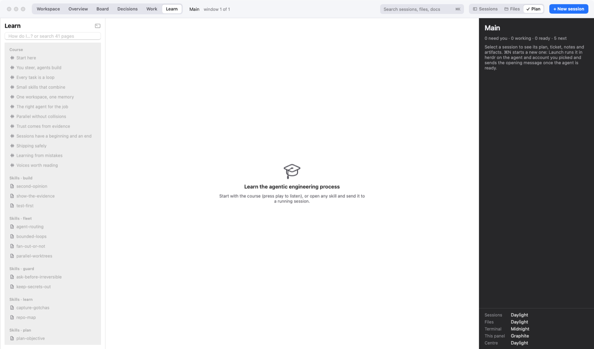
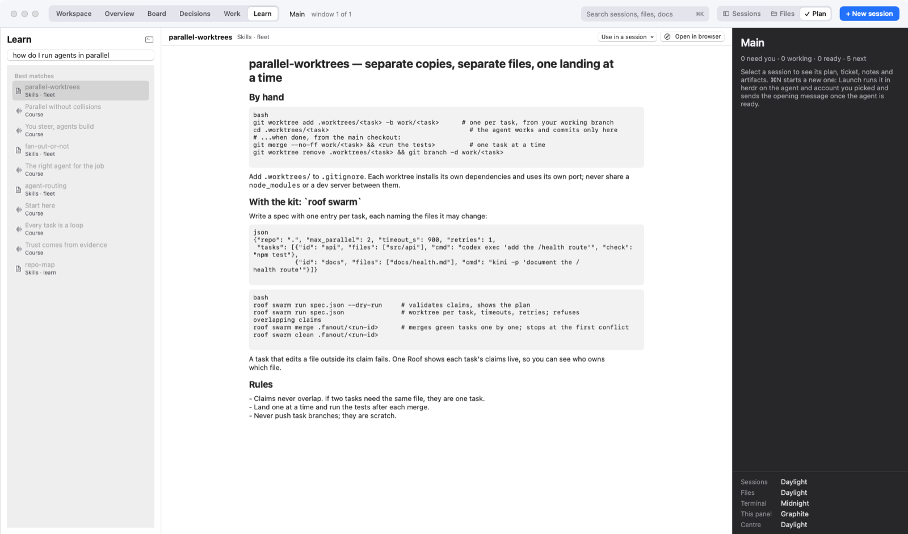
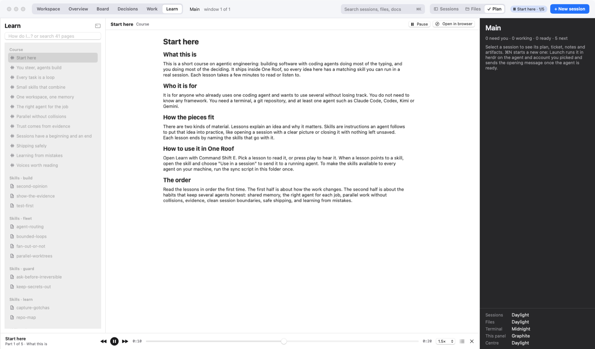

# One Roof help: Learn

**Status:** LIVE · **Date:** 2026-10-19

> **One line:** Learn (⇧⌘E) puts a short narrated course on agentic engineering, every skill's page and any Learn folders you add inside One Roof, read where they live and searchable in one list, with a player that keeps going while you work.

## Goal

Learning how to work with agents should not mean leaving the place where the work happens. Learn shows the material in One Roof but never copies it: each page is read from its folder every time you open it, so an edit there shows up here at once.

## Open it

- **⇧⌘E** (View › Learn), **Learn** in the toolbar, or "Learn" in the command palette.
- **From a skill:** the Learn button on any skill in Foundations › Skills, or pick a skill in the command palette.
- **Close it:** the terminal button at the top of the list, or ⇧⌘E again.

## What is in it

| Section | Where it is read from | What you get |
|---|---|---|
| Course | `course/` in your agentic engineering folder | The 12 lessons of the bundled course, from "Start here" to "Voices worth reading". Each lesson has narration: press **Play in One Roof**. |
| Skills | each skill's `SKILL.md` in the same folder | One page per skill, grouped (session, plan, build, fleet, guard, ship, learn for the bundled 17). |
| Your Learn folders | the folders you add in Settings › Foundations › Learn folders | Every Markdown page in them, and each folder of narration clips as a playlist. |
| Field manual | `content/field-manual/` in your own agentic engineering folder | Only if your folder has one. |
| Narrated skill pages | a `<skill>.html` page (and `<skill>_audio` folder) next to a skill's `SKILL.md` | Only if your folder has them; they replace the plain `SKILL.md` page. A waveform icon means the page has narration. |

The bundled agentic engineering folder has the course and the 17 skills. Choose your own folder, or add Learn folders, to see more.

## Browse and read

- **Search:** type in the box at the top. Plain words filter the list by title.
- **Read:** click a page. Markdown pages render as text; HTML pages show as they would in a browser, with their own pictures and scripts.
- **Open in browser:** the button at the top of an open page.
- **Send a skill to a session:** from Foundations › Skills, type `/name` into the selected session.

## How do I…? (⌥⌘/)

Ask a question in your own words and Learn finds the pages that answer it.

- **Ask:** Help › **How Do I…?** (**⌥⌘/**), or "How do I…? (Learn)" in the command palette, opens Learn with the cursor in the box. Type the question.
- **Best matches** appear at the top of the list, best first, and the best page opens by itself when you ask from a session. Below them come the pages whose title contains what you typed.
- **How it ranks:** by the words your question shares with each page's title, description and opening text. A title word counts more, and a word that is on nearly every page counts for little. Small words like "how", "do" and "the" are ignored, and "deploying" matches "deploy". There is no AI model and nothing leaves the Mac, so it is instant.

**From a session:** the plan panel of an agent session shows **Related in Learn**, the three pages that best match the session's name and objective (a "Flaky login test" session shows the test-first skill). Click one to open it. **More: how do I…** asks Learn with the session's objective. Plain terminals don't show it, because their name says nothing about the work.

## Listen while you work (the player)

One Roof has its own player for narration: every course lesson, every folder of narration clips in your Learn folders, and narrated skill pages if your folder has them.

- **Play:** on a page with narration, press **Play in One Roof** at the top. It plays the page's parts in order, one per section, each named after its section. For a folder of clips, click any part in the list to start from there.
- **Player bar** (bottom of Learn): the page and the part you are on, previous / play-pause / next, a scrubber, the **speed** (0.75× to 2×, remembered), the **queue** (jump to any part), and × to stop.
- **Keep working:** the audio carries on when you go back to the terminals or any other view. A **mini player** at the top shows what is playing. Its button pauses, and clicking the title opens that page in Learn again.
- **Continue where you left off:** One Roof remembers the part and second for each page. The button then says **Continue part 3**. When you hear a page to the end, it starts from the beginning next time.
- **Previous** goes to the start of the part if you are more than 3 seconds in, and to the part before otherwise.

## Make your own narrated pages

The bundled course is narrated with `scripts/make-audio.py` in the agentic engineering folder (it needs an `OPENAI_API_KEY`; only edited sections are re-recorded). For your own material, put Markdown pages and folders of `.mp3` clips in a folder and add it under Settings › Foundations › Learn folders.
