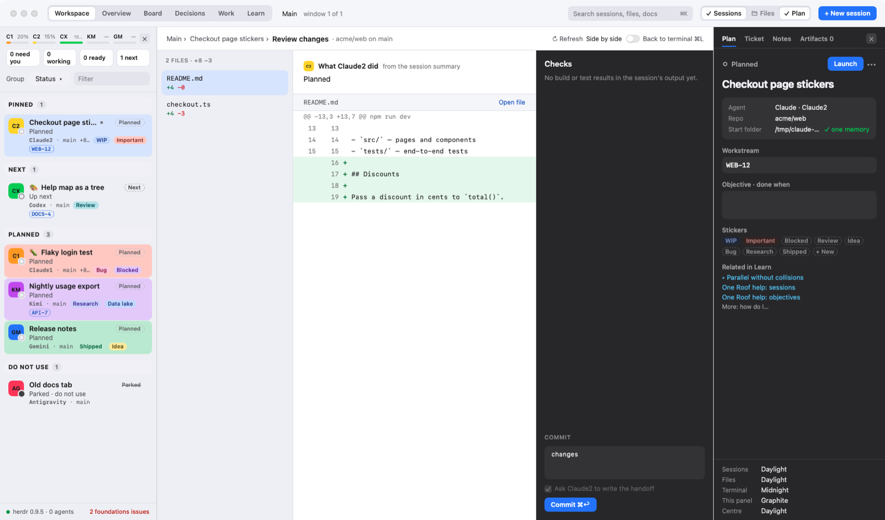
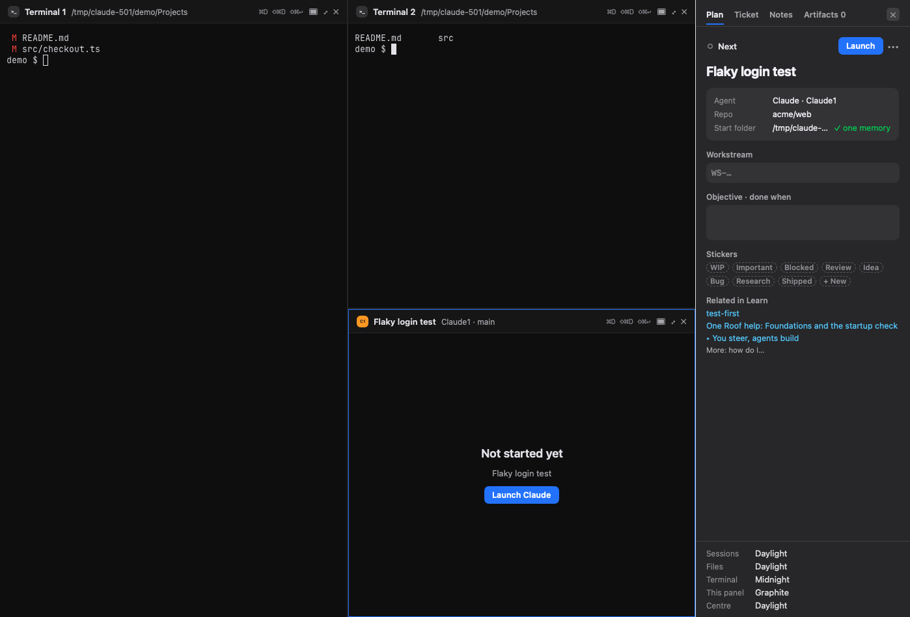

# One Roof help: review changes, split panes, session rows and reopen closed

**Status:** LIVE · **Date:** 2026-10-19

> **One line:** review an agent's uncommitted changes, comment on a line and commit (⌥⌘R), watch several sessions side by side in split panes (⌘D, ⇧⌘D), see each row's branch, change size and an unread dot, and bring back a session you closed (⇧⌘T).

## Goal

You should be able to check what an agent changed, tell it what to fix, commit, and keep two or three agents in view, all without leaving One Roof. One Roof never types into an agent that is working, and a review comment is no exception.

## Review changes (⌥⌘R)

**Open it** with View › Review Changes (**⌥⌘R**), right-click a row › Review Changes, or "Review changes (git diff)" in the command palette. It shows the git repo of the selected session in the centre: everything changed since the last commit (staged and unstaged) plus new files git does not track yet.

- **Top line:** the repo and branch, the number of files, lines added (+) and removed (−), **↻ Refresh**, and **Side by side** (⌥⌘D). It also refreshes by itself every few seconds.
- **Files (left):** one row per file with its +/− counts; new and deleted files are marked. Click a file.
- **Diff (middle):** each changed block, added lines green and removed lines red, under **What … did** (with the agent's name), a summary from the session. **Open file** shows the whole file.
- **Revert hunk** undoes that one block, in your working files and in the staged copy when it is staged too. One Roof asks first, because the change is thrown away and cannot be undone from One Roof. (Revert is in the normal view, not in Side by side.)
- **Comment:** click a line number and write what the agent should change. **Send to …** (the agent's name, ⌘↩) types `Review comment on <file>:<line>: <your text>` into the session working in this repo. If that agent is working right now, the comment is not sent; One Roof says that session is working and to send when it is idle. **Save as note** adds the comment to the session's notes instead.
- **Checks (right):** build and test results the session printed in its own terminal, never invented. **Ask to fix** sends a failing check to the agent.
- **Artifacts:** plan files, handoffs and screenshots for this session.
- **Commit:** a message filled in from the ticket key, the workstream and the session's summary (edit it), **Move ENG-42 to In Review** when the session has a ticket, and **Ask … to write the handoff**. **Commit** (⌘↩) stages every change in the repo (`git add -A`) and commits. It never pushes: you see "Committed. Nothing was pushed."
- **Messages:** "No changes since the last commit on main." when the tree is clean; "No live agent session in this repo." when nobody can receive a comment; "… is not in a git repo, so there is nothing to review." when the session's folder is not a repo.

Close the panel with **Back to terminal** (⌘L).

## Split panes

| Do this | Key | Menu |
|---|---|---|
| Split the focused pane, new pane on the right | ⌘D | View › Split Right |
| Split the focused pane, new pane below | ⇧⌘D | View › Split Down |
| Move focus to the pane on the left, right, above or below | ⌥⌘← ⌥⌘→ ⌥⌘↑ ⌥⌘↓ | View › Focus Pane … |
| Show only the focused pane, and back | ⇧⌘↩ | View › Maximize Pane |
| Close the focused pane | ⌥⌘W | View › Close Pane |
| Make every split half and half again | (none) | View › Even Out Panes |
| Resize | drag the line between two panes | |

- **A new pane starts empty:** "Pick a session to show it here, or ⌘T for a new terminal." Selecting a session in the sidebar fills the focused pane.
- **One session per pane, one pane per session.** Selecting a session that is already showing in another pane moves the focus there instead of showing it twice.
- **Click a pane** to focus it; the sidebar selection follows. The focused pane has a coloured border.
- **Each pane has a title strip** when the centre is split: status dot, session name, agent, and buttons to maximize or close that pane.
- **Closing a pane never closes the session.** Its agent keeps running in roofd; pick it again any time. The last pane cannot be closed.
- **Panes live in the terminals view.** Splitting from the Board, Work or the viewer switches back to the terminals first.
- **Remembered:** the pane layout and the focused pane come back when you reopen One Roof, and the focused pane's session is selected. Maximize is not remembered.

## What a session row shows

- **Branch and change size:** a chip such as `⎇ main +34 −5` on the row's third line: the repo's current branch, and lines added and removed since the last commit. Hover for the number of changed files. With only new, untracked files the chip can read `+0 −0`. A clean repo shows just the branch. Rows whose repo is your projects folder itself, and parked rows, show no chip. It refreshes every few seconds.
- **Unread dot:** a small dot before the name in the theme's accent colour. It means the agent finished a turn, went idle or needs you since you last had it selected or showing in a pane. It never shows on the selected session or on one you can see in a pane, and it clears as soon as you look. It starts fresh each time One Roof opens.

## Reopen a closed session (⇧⌘T)

File › Reopen Closed Session (**⇧⌘T**, or ⌥⌘T), or "Reopen closed session" in the palette.

- **What it remembers:** the last 20 sessions you closed (Close Agent…, Close Session) or deleted (Delete Session, Remove Exited Sessions), newest first.
- **What it does:** takes the newest one, puts its row back if you had deleted it (with its name, stickers, notes and opening message), selects it and launches it again with the same agent, account, model and arguments. A parked session is selected but not launched.
- **Nothing to reopen:** the plan panel says "Nothing closed to reopen."
- **Only for this run:** the list is kept in memory and is empty after One Roof restarts. Agents that an objective moved to another seat (rotation) are not on it.
- **⌃⌘T is different:** it opens a new plain terminal in the selected session's repo.
