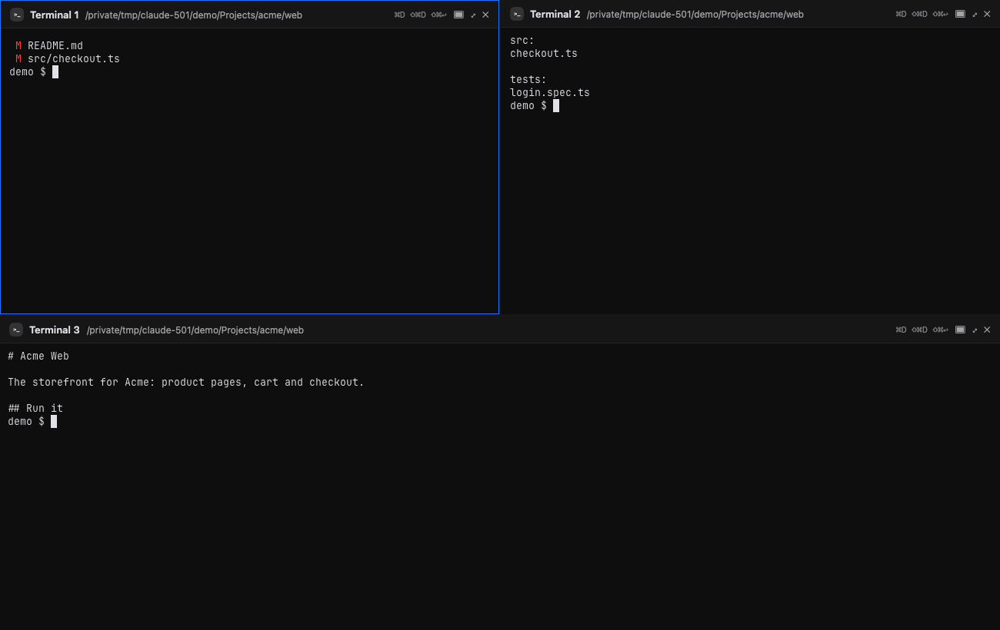

# One Roof help: roof windows

**Status:** LIVE · **Date:** 2026-10-20

> **One line:** a roof window shows every live session of one repo or one project side by side in its own window (⌥⌘N, or Window › Roof Windows), so a second screen can hold that work while the main window holds everything else. Read it with [split panes (page 10)](10_review-split-panes-and-session-rows.md).

## Goal

When several agents work in the same repo, or on the same project across repos, you should be able to watch all of them at once without rebuilding a split layout by hand, and put that view on another screen.

## Open one

- **For the selected session's repo:** File › New Roof Window for Selected Repo (**⌥⌘N**), or right-click a session row › **Roof Window for** the repo.
- **For any repo or project:** Window › **Roof Windows** lists every repo, then every project, that has live sessions, with how many. A tick marks the ones already open.
- **From the command palette (⌘K):** type "roof".

Opening the same repo or project again brings its window forward. It never opens a second copy.

## What it shows

- One pane per **live** session in that repo or project (planned and exited sessions have no terminal, so they stay in the sidebar). The panes form an even grid: two side by side, four as 2 × 2, five or six as two rows of three.
- Each pane has the same title strip as split panes: status dot, name, agent. **Maximize** (the arrows) fills the window with that pane, and pressing it again goes back to the grid. Drag the lines between panes to resize them.
- **Sessions join by themselves.** Start a new session in that repo (or tag one with that project) and it appears in the window within a second. When an agent exits, its pane goes away.
- The window title says which repo or project it is and how many sessions it holds.

## How it shares sessions with the main window

A session's terminal is in one place at a time. While a roof window holds a session, the main window shows **Open in its own window** for it, with two buttons:

- **Show window** brings the roof window forward.
- **Bring back here** takes that session out of the roof window and shows it in the main window again. It stays out of that roof window until you close and reopen it.

The **×** on a pane does the same as Bring back here: the agent keeps running, and only the view moves. Closing the roof window hands every session back to the main window. Nothing is stopped.

A session already popped out into its own window (Session › Open in New Window, ⌥⌘O) stays there and does not join a roof window.

## Good to know

- Roof windows are not reopened when One Roof restarts. Open them again from Window › Roof Windows. The window's size and place on screen are remembered per repo or project.
- The terminal theme follows Settings › Appearance › Terminal, the same as the main window.
